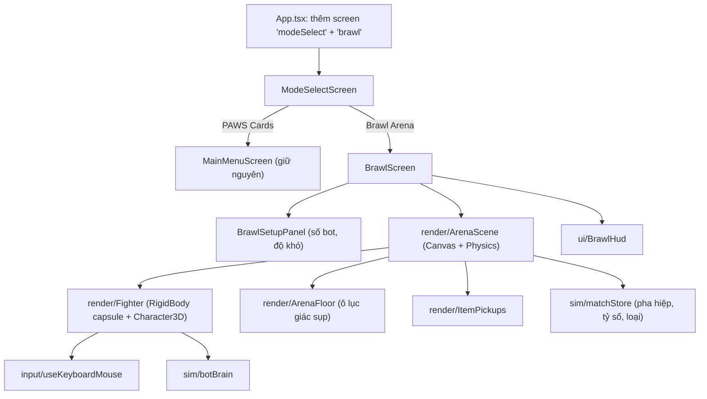

# Brawl Arena 3D — Design Spec (Minigame 2)

> Nguồn: `PAWS_web_game_plan (1).md` mục 11. Ngày: 2026-11-23.
> Chốt với người dùng: **bản đầy đủ nhưng 1 map**, **dùng `@react-three/rapier`**, **chỉ PC (bàn phím + chuột)**, **màn chọn chế độ riêng trước menu**.

## 1. Mục tiêu & phạm vi

Người chơi + 3–7 bot (thú cute dùng lại 8 con hiện có) bị thả vào đấu trường **Winter Cabin Arena**. Đấm, xô, nắm, ném nhau và nhặt vật phẩm. Sàn sụp dần từ ngoài vào. **Chơi đúng 3 hiệp, tính điểm theo thứ hạng từng hiệp (Hạng 1: +3đ, Hạng 2: +2đ, Hạng 3: +1đ) — tổng điểm cao nhất sau 3 hiệp vô địch** (nếu hòa điểm, ưu tiên người có nhiều lần Hạng 1 hơn, rồi thứ hạng hiệp 3).

**Có trong bản này**
- 1 map: Winter Cabin Arena (sàn tròn chia ô lục giác, sụp theo vòng có cảnh báo rung 2s).
- Hành động: chạy (WASD), nhảy (Space), đấm (chuột trái), nắm/ném (giữ/nhả E hoặc Shift), lăn né (Q / Ctrl, hồi chiêu 1.5s), emote (1–4).
- Thanh thăng bằng/choáng: bị đánh nhiều thì ngã (ragdoll-lite: thân đổ, tắt điều khiển 1.5–3s), dễ bị xô văng.
- Loại: rơi xuống vực (y < -5). Không dùng thanh máu (thuần đẩy ra khỏi map).
- Vật phẩm: cục tuyết (ném, đẩy lùi), xẻng tuyết (đấm xa + mạnh hơn), ca cao (hồi thăng bằng), giày trượt (chạy nhanh 6s), khiên nắp thùng (giảm knockback 5s), bom kẹo (ném, nổ sau 2s đẩy văng theo bán kính).
- **Lá bài PAWS rơi từ trời** (điểm nhấn): Kem Đá = đóng băng người gần nhất phía trước 2s; Tia Chớp = choáng tất cả trong bán kính 3; Vòng Xoay = đảo điều khiển mục tiêu gần nhất 5s.
- Bot AI 3 mức (dễ/vừa/khó) theo máy trạng thái.
- Camera 3/4 từ trên, tự zoom bao người còn sống; rung màn hình + hit-stop 60ms khi đấm trúng; chữ "Out!" khi rơi.
- HUD: số người còn lại, thời gian hiệp, tỷ số hiệp, hồi chiêu lăn, vật phẩm đang cầm, thanh thăng bằng của mình.
- Đếm ngược 3-2-1 đầu hiệp; bảng điểm sau mỗi hiệp; màn kết quả sau 3 hiệp; thưởng Cookies (Vô địch +40, Hạng 2 +25, Hạng 3 +15, tham gia +5).

**Không có (ngoài phạm vi)**: online multiplayer, mobile/touch, map thứ 2, full ragdoll có khớp động cơ, chế độ 2v2/King of the Hill, khán giả bóng ma.

## 2. Kiến trúc

Thư mục mới `src/brawl/` (theo mục 11.4 của kế hoạch, rút gọn cho offline):

| File | Trách nhiệm |
|---|---|
| `sim/types.ts` | Kiểu dữ liệu: `FighterState`, `ItemKind`, `MatchPhase`, `BotDifficulty` |
| `sim/constants.ts` | Hằng số tinh chỉnh (tốc độ, lực đấm, thời gian choáng, lịch sụp sàn) |
| `sim/matchStore.ts` | Trạng thái trận thuần (reducer): hiệp, tỷ số, người còn sống, người thắng. Không phụ thuộc React/Rapier → test được |
| `sim/combat.ts` | Hàm thuần: tính knockback, cộng/trừ thăng bằng, hiệu ứng lá bài/vật phẩm |
| `sim/arenaLayout.ts` | Sinh lưới ô lục giác + lịch sụp theo vòng |
| `sim/botBrain.ts` | Máy trạng thái bot: nhặt đồ → tìm mục tiêu → áp sát → đấm/nắm → về giữa khi sàn sụp |
| `input/useKeyboardMouse.ts` | Đọc phím/chuột thành `FighterInput` mỗi frame |
| `render/ArenaScene.tsx` | `<Canvas>` + `<Physics>` (Rapier, fixed timestep 60Hz), ánh sáng, tuyết |
| `render/ArenaFloor.tsx` | Các ô sàn (RigidBody fixed → chuyển dynamic khi sụp) |
| `render/Fighter.tsx` | Capsule `RigidBody` + model `Character3D`; áp lực di chuyển, đấm (sensor nắm tay), nắm (joint tạm), choáng |
| `render/ItemPickups.tsx` | Spawn vật phẩm/lá bài rơi từ trời, xử lý nhặt |
| `render/BrawlCamera.tsx` | Camera 3/4 bám nhóm + rung màn hình |
| `ui/BrawlHud.tsx`, `ui/BrawlResult.tsx`, `ui/BrawlSetupPanel.tsx` | HUD, màn kết quả, thiết lập trận |
| `screens/BrawlScreen.tsx` | Ghép mọi thứ, nối Cookies (`recordMatchResult` hoặc hàm cộng cookie có sẵn) |
| `screens/ModeSelectScreen.tsx` | Màn chọn chế độ PAWS Cards / Brawl Arena |

Nguyên tắc: logic trận/combat là **hàm thuần** trong `sim/`; Rapier chỉ ở `render/`. Trạng thái tần suất cao (vị trí, vận tốc) sống trong ref/Rapier, không đưa vào React state để giữ 60fps. React state chỉ giữ thứ HUD cần (tỷ số, người còn sống, hồi chiêu — cập nhật ~10Hz).

## 3. Luồng dữ liệu một hiệp

1. `countdown` (3s) → khóa input.
2. `fighting`: mỗi frame (`useFrame`), mỗi Fighter đọc input (bàn phím hoặc `botBrain`) → áp vận tốc/impulse lên RigidBody. Va chạm sensor nắm tay → `combat.applyHit()` → impulse knockback + giảm thăng bằng; thăng bằng ≤ 0 → choáng.
3. Lịch sụp sàn: 30s đầu an toàn; sau đó mỗi 12s một vòng ngoài rung 2s rồi rơi; đến 90s chỉ còn vòng trong cùng → đảm bảo hiệp kết thúc (~2–3 phút).
4. Fighter có y < -5 → dispatch `ELIMINATE` (ghi nhận thứ tự bị loại để xếp hạng) → còn ≤ 1 người → cộng điểm hiệp (Hạng 1: +3đ, Hạng 2: +2đ, Hạng 3: +1đ) → `roundOver` (2.5s hiện bảng điểm) → hiệp tiếp theo (hiệp 1→2→3) hoặc `matchOver` sau hiệp 3.

## 4. Xử lý lỗi & biên

- Rapier WASM tải lỗi → hiện thông báo lỗi + nút quay lại chế độ chọn (không trắng màn hình). Rapier được `lazy()` load chỉ khi vào Brawl để không làm nặng PAWS Cards.
- Tab ẩn (`visibilitychange`) → tạm dừng mô phỏng.
- Tất cả cùng rơi trong 1 frame → cùng chia thứ hạng còn lại (hoặc đồng hạng), vẫn tính điểm và chuyển hiệp bình thường.
- Con trỏ: dùng click bình thường (không Pointer Lock) để tránh phức tạp; hướng nhìn = hướng di chuyển, đấm theo hướng đang quay mặt.

## 5. Kiểm chứng

- Dự án chưa có test runner (không có Vitest). Đề xuất: **không thêm Vitest** trong lần này; kiểm chứng bằng `npm run build` (tsc strict) + chơi thử trên trình duyệt qua browser subagent (đếm ngược, đấm văng bot, sàn sụp, kết thúc hiệp, bảng điểm 3 hiệp, Cookies cộng đúng).
- Nếu muốn test thuần cho `sim/` (matchStore, combat, arenaLayout) thì cần thêm `vitest` — sẽ hỏi riêng.

## 6. Dependency mới

- `@react-three/rapier` (bản tương thích `@react-three/fiber` v9 / React 19). Kéo theo `@dimforge/rapier3d-compat`. Không thêm gì khác.

## 7. Thứ tự triển khai (tóm tắt, chi tiết sẽ ở implementation plan)

1. Cài Rapier, ModeSelectScreen + route, BrawlScreen khung.
2. Arena phẳng + 1 Fighter điều khiển được (chạy/nhảy/lăn).
3. Đấm, knockback, thăng bằng, choáng, rơi = loại; bot đứng yên.
4. matchStore: đếm ngược, xếp hạng từng hiệp, tính điểm 3 hiệp (3/2/1đ), kết quả, Cookies.
5. Sàn lục giác sụp theo vòng.
6. Nắm/ném + vật phẩm + lá PAWS rơi từ trời.
7. Bot AI 3 mức.
8. HUD, camera, juice (rung, hit-stop, "Out!"), âm thanh (dùng `playSfx` có sẵn).
