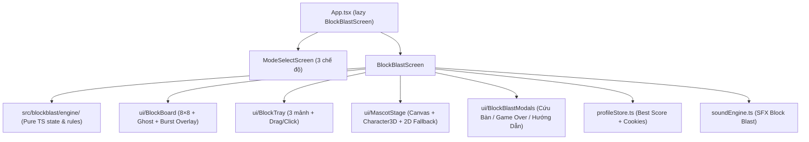

# Block Blast PAWS — Design Spec (Minigame 3)

> Ngày: 2026-11-25.
> Đã chốt với người dùng qua brainstorming:
> 1. **Phong cách hình ảnh:** Bảng 2D Tactile sắc nét (`DOM/CSS Grid`) kết hợp **Mascot thú bông 3D** (`Character3D` + phụ kiện đang đeo) cổ vũ theo thời gian thực; hỗ trợ mượt cả chuột PC và cảm ứng.
> 2. **Lối chơi:** Classic 8×8 chuẩn Block Blast (khay 3 mảnh, ăn hàng/cột, Combo & Streak) + **PAWS Twist nhẹ** (Bom Kẹo nổ 3×3 & nút Đổi Khay).
> 3. **Kinh tế Cookies & Công bằng:** Mỗi ván có **1 lượt Đổi Khay miễn phí** + **1 lượt Bom Kẹo/Cứu Bàn giá 15 Cookies** (tối đa 1 lần/ván để giữ công bằng High Score); kết thúc ván thưởng tối đa **45–50 Cookies** theo điểm số và lưu kỷ lục vào hồ sơ người chơi.

---

## 1. Mục tiêu & Phạm vi

Bổ sung **Block Blast PAWS** thành minigame thứ 3 trong `PAWS ARCADE 3D`, đứng cạnh `PAWS Cards 3D` và `Brawl Arena 3D` trên màn hình chọn chế độ, sử dụng chung hệ thống nhân vật 3D, 15 phụ kiện phối đồ, ví Cookies, thiết lập âm thanh/trợ năng (`sfxEnabled`, `bgmEnabled`, `colorblindMode`, `reducedMotion`) và phong cách Winter Cabin Tactile Arcade.

**Trong phạm vi bản này:**
- Bảng chơi `8×8`, khay 3 mảnh ghép sinh theo thuật toán **Smart Fair Spawner** (29 hình khối tiêu chuẩn đối xứng đều các hướng + Bom Kẹo `1×1`).
- Kéo-thả mượt bằng Pointer Events (`touch-action: none`, nâng vị trí mảnh khi chạm ngón tay) + cơ chế Click-to-select & Click-on-board dự phòng + phím `Esc` hủy chọn.
- Ghost preview ô hợp lệ + phát sáng toàn bộ hàng/cột chuẩn bị bị xóa trước khi thả tay.
- Tính điểm, chuỗi Combo Streak (có 1 lượt đệm), All Clear (`+1,000`), Bom Kẹo nổ `3×3`, Đổi Khay miễn phí 1 lần/ván, Bom Kẹo / Cứu Bàn 15 Cookies 1 lần/ván.
- Mascot 3D tái sử dụng [Character3D.tsx](file:///d:/Codes/LandingPageFunny/paws-game/src/scene3d/Character3D.tsx) và [WinterCabinStage.tsx](file:///d:/Codes/LandingPageFunny/paws-game/src/scene3d/WinterCabinStage.tsx) với biểu cảm động (`idle`, `happy`, `win`, `shock`, `sad`) + lời thoại ngắn, có ErrorBoundary 2D fallback nếu WebGL lỗi.
- Tích hợp `blockBlastBestScore`, `recordBlockBlastResult`, `spendCookies` vào [profileSchema.ts](file:///d:/Codes/LandingPageFunny/paws-game/src/store/profileSchema.ts) & [profileStore.ts](file:///d:/Codes/LandingPageFunny/paws-game/src/store/profileStore.ts).
- Bổ sung 5 hiệu ứng âm thanh tổng hợp trong [soundEngine.ts](file:///d:/Codes/LandingPageFunny/paws-game/src/audio/soundEngine.ts).
- Nâng cấp [ModeSelectScreen.tsx](file:///d:/Codes/LandingPageFunny/paws-game/src/screens/ModeSelectScreen.tsx) thành 3 thẻ chế độ kèm banner 16:9 riêng cho Block Blast.

**Ngoài phạm vi bản này:**
- Chế độ Adventure theo màn cố định hoặc bảng xếp hạng Online/Multiplayer.
- Xoay mảnh thủ công (giữ đúng tinh thần Block Blast cổ điển).
- Hồi sinh nhiều lần không giới hạn trong cùng một ván.

---

## 2. Kiến trúc & Dữ liệu

### 2.1. Chọn phương án kỹ thuật

Đã thống nhất chọn **Phương án 1 (Pure TS Engine + Tactile DOM/CSS Grid + R3F Mascot Companion)** thay cho HTML5 2D Canvas thuần hoặc UI 2D không có Mascot 3D:
- Logic toàn bộ nằm dưới dạng hàm thuần trong `src/blockblast/engine/` để kiểm thử độc lập qua `node:test` (đồng bộ với `src/engine/` và `src/brawl/sim/`).
- Bảng `8×8` dùng DOM/CSS Grid + Pointer Events cho độ sắc nét retina, hỗ trợ focus/a11y và đồng bộ token `.btn-tactile-*` của Tailwind v4.
- Màn chơi được `lazy()` load từ [App.tsx](file:///d:/Codes/LandingPageFunny/paws-game/src/App.tsx) tương tự `BrawlScreen` để không tăng kích thước bundle khởi đầu của `ModeSelectScreen` hay `PAWS Cards 3D`.

### 2.2. Sơ đồ luồng dữ liệu

### 2.3. Danh sách file & trách nhiệm

| File | Trách nhiệm |
|---|---|
| `src/blockblast/engine/types.ts` | Kiểu dữ liệu `BlockColor`, `CellData`, `Grid` (8×8), `PieceKind`, `PieceDef`, `TrayPiece`, `PlacementPreview`, `ClearEvent`, `BlastGameState` |
| `src/blockblast/engine/pieces.ts` | 29 hình polyomino chuẩn (`ShapeCell[]`), 6 màu kẹo PAWS (`PALETTE`) kèm nhãn icon cho chế độ mù màu, hàm `createCandyBombPiece()` |
| `src/blockblast/engine/game.ts` | Hàm thuần & PRNG `mulberry32`: `createInitialState`, `canPlacePiece`, `getPlacementPreview`, `placePiece`, `detonateCandyBombAt`, `rerollTray`, `declineRescue`, `hasAnyValidMove`, `calculateCookieReward`, `getBoardFillRatio` |
| `src/blockblast/engine/verify.ts` | Xác thực chống gian lận: `MatchAction`, `MatchReceipt`, `verifyMatchReceipt` (replay toàn bộ nước đi từ `seed` và kiểm tra tính hợp lệ + nhịp thời gian) |
| `src/blockblast/engine/__tests__/game.test.ts` | Bộ unit test `node:test` cho toàn bộ luật chơi, biên lưới, streak, Bom Kẹo, Smart Spawner, thưởng Cookies và replay verification chống giả mạo |
| `src/blockblast/ui/BlockBoard.tsx` | Render lưới 8×8, ô màu nổi 3D-lite, ghost preview, highlight hàng/cột sắp nổ, preview vùng nổ 3×3 khi ngắm Bom Kẹo, floating score & particle burst |
| `src/blockblast/ui/BlockTray.tsx` | Khay 3 mảnh ghép, render preview từng mảnh theo tỉ lệ lưới đồng nhất, xử lý Pointer Down để kéo hoặc Click để chọn, hiển thị trạng thái không đặt được (dim nhẹ khi bàn chật) |
| `src/blockblast/ui/MascotStage.tsx` | Khung 3D `Character3D` + `WinterCabinStage` bám cảm xúc (`idle`/`happy`/`win`/`shock`/`sad`), bong bóng thoại, tạm dừng `frameloop` khi mở modal/ẩn tab, kèm ErrorBoundary fallback sang thẻ 2D |
| `src/blockblast/ui/BlockBlastModals.tsx` | Native `<dialog>` (`showModal()`) cho **Cứu Bàn?** (15 Cookies), **Game Over** (tổng điểm, New Best, dòng đã xóa, max combo, Cookies thưởng), **Hướng Dẫn** & **Xác Nhận Chơi Lại** |
| `src/screens/BlockBlastScreen.tsx` | Điều phối vòng đời ván chơi, ghi `MatchAction[]`, floating drag layer theo con trỏ (offset nâng ngón tay cho touch), thanh công cụ Đổi Khay / Bom Kẹo, liên kết `profileStore` & `soundEngine` |
| `src/store/profileIntegrity.ts` | Pure TS SHA-256 HMAC, `safeJsonParse` chống prototype pollution, bọc/xác minh phong bì `v2` cho `localStorage` |
| `src/store/profileSchema.ts`, `profileStore.ts` | Thêm `blockBlastBestScore`, `settledMatchIds`, `recordBlockBlastResult(receipt)`, `spendBlockBlastBomb(matchId)`, kiểm tra toàn vẹn chữ ký |
| `src/audio/soundEngine.ts` | Thêm SFX `blockPickup`, `blockPlace`, `lineClear`, `candyBomb`, `reroll` |
| `src/App.tsx`, `src/screens/ModeSelectScreen.tsx`, `vercel.json` | Route `'blockblast'`, nâng lưới hub lên 3 thẻ (`md:grid-cols-3`), hiển thị kỷ lục Block Blast, banner `public/banners/block-blast-banner.{webp,jpg}` và Security Headers |

---

## 3. Luật chơi, Thuật toán & Công thức chi tiết

### 3.1. Bộ 29 hình khối & Màu sắc

- **Nhóm Nhỏ (1–3 ô · 9 khối):** `dot_1` (`1×1`), `bar_h2` (`1×2`), `bar_v2` (`2×1`), `bar_h3` (`1×3`), `bar_v3` (`3×1`), và 4 góc L-3 ô (`corner_tl`, `corner_tr`, `corner_bl`, `corner_br`).
- **Nhóm Vừa (4 ô · 13 khối):** `square_2` (`2×2`), `bar_h4` (`1×4`), `bar_v4` (`4×1`), 4 hướng chữ T (`t_up`, `t_down`, `t_left`, `t_right`), 4 hướng chữ L-4 ô (`l4_tl`, `l4_tr`, `l4_bl`, `l4_br`), và 2 chữ Z/S ngang (`z_h`, `s_h`).
- **Nhóm Lớn (5–9 ô · 7 khối):** `bar_h5` (`1×5`), `bar_v5` (`5×1`), `square_3` (`3×3`), và 4 hướng góc L-5 ô kích thước 3×3 (`big_corner_tl`, `big_corner_tr`, `big_corner_bl`, `big_corner_br`).
- **Mảnh đặc biệt:** `candy_bomb` (`1×1`, `kind: 'candyBomb'`).
- **Bảng màu 6 loại (`BlockColor`):** `amber` (Vàng Mật Ong), `rose` (Hồng Dâu), `sky` (Xanh Băng), `emerald` (Xanh Bạc Hà), `violet` (Tím Oải Hương), `orange` (Cam Lò Sưởi). Khi `colorblindMode === true`, mỗi ô hiển thị thêm họa tiết hình học nhỏ có độ tương phản rõ để phân biệt không phụ thuộc màu.

### 3.2. Smart Fair Spawner (Sinh khay 3 mảnh)

Khi khay hết cả 3 mảnh (hoặc khi người chơi bấm **Đổi Khay**):
1. Tính độ đầy bàn `fillRatio = occupiedCells / 64`.
2. Chọn trọng số nhóm kích thước:
   - `fillRatio < 0.45`: Nhỏ 35%, Vừa 45%, Lớn 20%.
   - `0.45 <= fillRatio <= 0.70`: Nhỏ 50%, Vừa 38%, Lớn 12%.
   - `fillRatio > 0.70`: Nhỏ 68%, Vừa 27%, Lớn 5%.
3. Sinh 3 mảnh (có tối đa 1 cơ hội ~8% xuất hiện 1 `candy_bomb` thay cho 1 mảnh thường nếu trên khay chưa có bom).
4. **Bảo chứng công bằng:** Nếu ít nhất 1 hình khối trong bộ 29 khối thường đặt được lên bàn hiện tại mà khay vừa sinh lại có **0/3 mảnh đặt được**, thay thế mảnh đầu tiên (index 0) bằng một mảnh chọn ngẫu nhiên từ tập các hình khối thực sự đặt vừa vào bàn hiện tại.

### 3.3. Đặt mảnh, Bom Kẹo & Xóa dòng

- **Đặt mảnh thường (`normal`):**
  - Hợp lệ khi toàn bộ các ô `(originRow + dr, originCol + dc)` nằm trong `0..7` và đều là `null`.
  - Điểm đặt mảnh: `+10 × piece.cells.length`.
  - Sau khi đặt, kiểm tra đồng thời tất cả hàng `0..7` đủ 8 ô và cột `0..7` đủ 8 ô.
  - Gọi `L = clearedRows.length + clearedCols.length`:
    - Nếu `L > 0`:
      - Xóa toàn bộ ô thuộc các hàng/cột đó cùng lúc.
      - Điểm xóa dòng cơ bản: `100 * L * (L + 1) / 2`.
      - Tăng `streak += 1`, đặt `graceUsed = false` (chưa dùng lượt đệm).
      - Thưởng streak: `50 * (streak - 1)`.
      - Cập nhật `maxStreak = Math.max(maxStreak, streak)`.
      - Nếu sau khi xóa toàn bộ 64 ô đều trống (`occupiedCells === 0`): thưởng **All Clear `+1,000`**.
    - Nếu `L === 0` (đặt mảnh không xóa dòng):
      - Nếu `streak > 0` và `!graceUsed`: giữ `streak`, đặt `graceUsed = true` (cho phép tối đa 1 lượt đặt đệm).
      - Ngược lại (`graceUsed === true` hoặc `streak === 0`): reset `streak = 0`, `graceUsed = false`.
- **Đặt Bom Kẹo ngẫu nhiên trên khay (`candy_bomb` 1×1):**
  - Đặt vào một ô **trống** hợp lệ `(r, c)`.
  - Kích nổ vùng `3×3` có tâm `(r, c)` (gồm tất cả các ô trong `[r-1..r+1] × [c-1..c+1]` thuộc phạm vi `0..7`): xóa mọi ô đang có gạch trong vùng đó.
  - Điểm: `+10` (đặt bom) `+ 15 × destroyedCount`. Không phá chuỗi `streak` đang có (giữ nguyên `streak` và `graceUsed` như một lượt an toàn).
- **Kích hoạt nút Bom Kẹo / Cứu Bàn (15 Cookies · tối đa 1 lần/ván):**
  - Điều kiện khả dụng: `!state.candyBombUsed`, `!state.isGameOver`, và `cookies >= 15`.
  - Người chơi bấm nút **Bom Kẹo (15 Cookies)** để vào chế độ `bombAiming = true` (có nút/Esc để Hủy nếu chưa thả).
  - Trong `bombAiming`, người chơi có thể di chuyển và nhấn vào **bất kỳ ô nào** `(r, c)` trên lưới `8×8` (kể cả ô đã có gạch) để xem preview vùng nổ `3×3` và kích nổ dọn sạch mọi ô trong vùng `3×3` đó.
  - Khi kích nổ thành công: trừ `15 Cookies` qua `spendBlockBlastBomb(matchId)`, đánh dấu `candyBombUsed = true`, cộng `+15 × destroyedCount` điểm (không reset `streak`), sinh lại kiểm tra trạng thái nước đi tiếp theo.
- **Nút Đổi Khay (Miễn phí · tối đa 1 lần/ván):**
  - Điều kiện khả dụng: `!state.rerollUsed`, `!state.isGameOver`, và còn ít nhất 1 mảnh chưa đặt trên khay.
  - Thay mới toàn bộ 3 ô khay bằng bộ 3 mảnh mới theo **Smart Fair Spawner**, đánh dấu `rerollUsed = true`, giữ nguyên `streak`.

### 3.4. Kết thúc ván & Thưởng Cookies

- Sau mỗi lần đặt mảnh / kích nổ Bom Kẹo / Đổi Khay, kiểm tra `hasAnyValidMove(grid, tray)`:
  - Nếu khay hết cả 3 mảnh $\rightarrow$ sinh khay mới và kiểm tra lại `hasAnyValidMove`.
  - Nếu **không có mảnh nào trong khay đặt vừa** lên bàn:
    - Nếu `!state.candyBombUsed && cookies >= 15 && !state.rescueDeclined`: chuyển sang trạng thái `phase = 'rescuePrompt'` (hiện modal **Cứu Bàn?** với lựa chọn **Dùng Bom Kẹo (15 Cookies)** — mở ngay chế độ `bombAiming` — hoặc **Kết Thúc Ván**). Nếu đang ở `bombAiming` từ `rescuePrompt` mà bấm Hủy/`Esc`, quay lại `rescuePrompt` chứ chưa trừ Cookies.
    - Nếu chọn **Kết Thúc Ván** hoặc đã dùng Bom Kẹo / không đủ 15 Cookies: chuyển `phase = 'gameOver'`, chốt điểm thưởng Cookies và cập nhật `blockBlastBestScore`.
- **Nút Chơi Lại giữa ván:** Nếu `movesCount === 0` thì reset ngay lập tức; nếu đã chơi (`movesCount > 0`), hiện hộp thoại xác nhận nhẹ để tránh bấm nhầm mất điểm đang chơi (chỉ tính thưởng Cookies khi đạt `gameOver` tự nhiên để tránh spam reset kiếm Cookies).
- **Bảng tính Cookies khi kết thúc ván (`calculateCookieReward(score, prevBest)`):**
  - `score < 300`: `5` Cookies
  - `300 <= score < 1000`: `12` Cookies
  - `1000 <= score < 2500`: `22` Cookies
  - `2500 <= score < 5000`: `35` Cookies
  - `score >= 5000`: `45` Cookies
  - Bonus kỷ lục: nếu `prevBest > 0 && score > prevBest`, cộng thêm `+5` Cookies (`isNewBest = true`, tổng tối đa **50 Cookies**).

---

## 4. Giao diện, Tương tác & Xử lý lỗi

### 4.1. Bố cục `BlockBlastScreen`
- **Desktop (`lg` trở lên):**
  - Top bar gọn: nút `Quay Lại Chế Độ`, badge `Block Blast PAWS`, bộ đếm `Cookies`, `Kỷ Lục (Best)`, nút âm thanh (`SFX`/`BGM`) & nút `Hướng Dẫn`.
  - Khu vực chính 2 cột cân đối (`max-w-5xl` / `max-w-6xl`):
    - **Trái (`~300–340px`):** Thẻ **Mascot 3D** (`Character3D` trên `WinterCabinStage`), hiển thị tên thú + phụ kiện đang đeo, bong bóng thoại phản ứng theo combo/tình trạng bàn, kèm thẻ **Điểm hiện tại**, **Combo Streak** và 2 nút kỹ năng **Đổi Khay (Miễn phí)** + **Bom Kẹo (15 Cookies)**.
    - **Phải (trung tâm):** Bảng lưới `8×8` nổi bật trên khung gỗ Winter Cabin ấm áp, ngay dưới là **Khay 3 mảnh** lớn dễ kéo.
- **Mobile / Màn hình hẹp:**
  - Mascot 3D chuyển thành dải header đồng hành nhỏ gọn hoặc avatar 3D mini bên cạnh bảng điểm để đảm bảo **Bảng 8×8 + Khay 3 mảnh nằm trọn trong 1 màn hình (không phải cuộn dọc khi kéo gạch)**.

### 4.2. Tương tác Kéo-Thả & A11y
- Đặt `touch-action: none` và `select-none` trên khay và bảng khi thao tác để ngăn trình duyệt cuộn/zoom nhầm lúc kéo gạch.
- **Tính toán vị trí snap:** Dựa vào `boardRef.getBoundingClientRect()`, quy đổi tọa độ tâm khối đang nổi sang chỉ số `(row, col)` làm neo đặt mảnh. Khi kéo bằng cảm ứng (`e.pointerType === 'touch'`), khối đang kéo nâng lên `56px` phía trên đầu ngón tay để tầm nhìn luôn thông thoáng.
- **Phản hồi tức thì:**
  - Ghost preview hiển thị màu bán trong suốt nếu vị trí hợp lệ (hoặc khung đỏ mờ nhẹ nếu không vừa).
  - Nếu vị trí hợp lệ sẽ tạo ra hàng/cột đầy, **toàn bộ các ô thuộc hàng/cột đó phát sáng viền vàng/trắng** ngay lúc rê mảnh qua.
  - Khi thả tay thành công, state cập nhật ngay lập tức (`0ms` input lock), đồng thời mảng `burstEffects` phát animation nổ hạt & chữ điểm bay lên (`+300`, `Combo ×3!`, `All Clear!`) ở lớp overlay `pointer-events-none`.
- **Hỗ trợ Click-to-Place & Keyboard:** Nhấn (click ngắn không kéo) vào một mảnh trên khay sẽ đánh dấu mảnh đang chọn (`selectedSlot`); rê/click vào ô trên bảng để đặt, hoặc bấm `Esc` để bỏ chọn.

### 4.3. Xử lý lỗi & Edge Cases
- **Pointer cancel / mất focus cửa sổ (`window.blur`):** Tự động hủy drag đang dở, trả mảnh về khay nguyên trạng.
- **Lỗi WebGL trên `MascotStage`:** Bọc riêng `MascotStage` bằng React `ErrorBoundary` — nếu Three.js/WebGL lỗi, thay bằng thẻ chân dung thú 2D dễ thương, người chơi vẫn chơi Block Blast 2D bình thường.
- **Tương thích `localStorage` cũ:** `sanitizeProfileData` trong [profileSchema.ts](file:///d:/Codes/LandingPageFunny/paws-game/src/store/profileSchema.ts) gán mặc định `blockBlastBestScore: 0` nếu key chưa tồn tại hoặc dữ liệu không hợp lệ (`Number.isFinite` và `>= 0`).
- **Tối ưu GPU:** `Canvas` của `MascotStage` đặt `frameloop={paused ? 'never' : 'always'}` khi mở modal hoặc khi `document.hidden === true`.

### 4.4. Bảo mật & Chống Gian Lận (Anti-Hack)

> **Giới hạn trung thực (Client-side ceiling):** Vì `paws-game` hiện là ứng dụng client SPA không có backend server lưu hồ sơ/tiền tệ riêng, không cơ chế phía trình duyệt nào có thể ngăn 100% kẻ tấn công có chủ đích debug trực tiếp bộ nhớ JS. Các lớp dưới đây chặn triệt để việc sửa tay `localStorage`, giả mạo điểm thưởng qua UI state, double-claim Cookies và khai thác prototype pollution, đồng thời thiết kế sẵn `MatchReceipt` để dễ dàng chuyển lên xác thực phía server nếu bổ sung backend sau này.

1. **Signed Profile Envelope (`src/store/profileIntegrity.ts`):**
   - Dữ liệu lưu tại `localStorage` được bọc trong phong bì `{ v: 2, data, nonce, savedAt, sig }` ký bằng **HMAC-SHA256 thuần TypeScript** (đồng bộ).
   - Migration 1 lần từ hồ sơ `v1` hợp lệ (không có `blockBlastBestScore`); từ chối mọi payload `v2` sai chữ ký hoặc payload hạ cấp giả mạo, reset về mặc định an toàn và báo cờ `tamperDetected`.
   - `safeJsonParse` lọc bỏ `__proto__`, `constructor`, `prototype`; `sanitizeProfileData` kẹp biên hợp lý (`cookies <= 1_000_000`, `blockBlastBestScore <= 10_000_000`, `gamesWon <= gamesPlayed`).
2. **Deterministic Seeded Replay Verification (`src/blockblast/engine/verify.ts`):**
   - Mỗi ván khởi tạo `matchId` + `seed` 32-bit từ `crypto.getRandomValues` (dùng PRNG `mulberry32` thuần định tính) và ghi nhận toàn bộ nước đi vào nhật ký `MatchAction[]`.
   - `recordBlockBlastResult(receipt)` trong `profileStore.ts` **không nhận số điểm trần**, mà tự replay lại toàn bộ ván đấu từ `(seed, actions)` để xác nhận: mọi nước đi hợp lệ, trạng thái cuối là `gameOver`, điểm tính lại khớp 100% với `claimedScore`, nhịp thời gian khả thi (`elapsedMs >= actions.length * 100`), và `matchId` chưa từng được nhận thưởng trước đó (`settledMatchIds`, chặn double-claim).
3. **Biên an toàn & Headers:**
   - Cấm `innerHTML`, `dangerouslySetInnerHTML`, `eval`, và không gắn store/game state lên `window`.
   - Bổ sung Security Headers tương thích Vite/Rapier WASM/Supabase trong `vercel.json` (`X-Content-Type-Options`, `X-Frame-Options`, `Referrer-Policy`, `Permissions-Policy`).

---

## 5. Kiểm chứng

1. **Unit tests (`node:test`):**
   - `src/blockblast/engine/__tests__/game.test.ts`: Kiểm tra đặt mảnh biên `0..7`, từ chối ô trùng/ngoài biên, xóa đồng thời nhiều hàng + cột (`L = 1, 2, 3, 4`), cộng điểm & streak có 1 lượt đệm, All Clear `+1,000`, Bom Kẹo `3×3` tại góc và giữa bàn, Smart Fair Spawner luôn tạo ít nhất 1 nước đi khi bàn còn chỗ, Đổi Khay, Cứu Bàn / Game Over, công thức tính Cookies & New Best.
   - Mở rộng `src/store/__tests__/profileStore.test.ts`: Kiểm tra `sanitizeProfileData` cho `blockBlastBestScore`, `recordBlockBlastResult`, `spendCookies`.
2. **Type-check & Build:** Chạy toàn bộ test suite hiện có + `npm run build` (`tsc --noEmit && vite build`).
3. **Kiểm thử giao diện trực tiếp (`browser` subagent):** Khởi chạy dev server, kiểm tra điều hướng từ `ModeSelectScreen` (3 thẻ + banner 16:9), kéo-thả & click đặt mảnh, ghost preview, ăn hàng + cộng điểm, dùng Đổi Khay, dùng Bom Kẹo, Game Over và xác minh số Cookies + Best Score cập nhật đúng.
