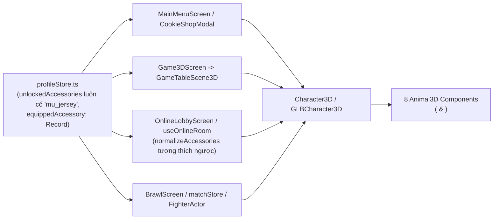

# Hệ Thống Phụ Kiện Đa Vùng & Áo Đấu MU — Design Spec

> Ngày: 2026-11-25.
> Đã chốt với người dùng qua brainstorming:
> 1. **Mặc định thêm phụ kiện Áo MU**: Áo đấu MU (đỏ Manchester United) được **mở khóa sẵn miễn phí** trong kho đồ của mọi người chơi ngay từ đầu (`price: 0`, luôn có trong `unlockedAccessories`).
> 2. **Cơ chế kết hợp nhiều phụ kiện**: Chia **5 vùng không đè nhau** (`outfit`, `neck`, `eyes`, `hat`, `back`) — mỗi vùng đeo tối đa 1 món, cho phép phối tối đa 5 phụ kiện cùng lúc trên 1 nhân vật.
> 3. **Quy mô bộ phụ kiện**: Mở rộng đầy đủ **15 phụ kiện** chia đều 5 vùng.

---

## 1. Mục tiêu & Phạm vi

Mở rộng hệ thống cửa hàng và phụ kiện 3D để người chơi phối tự do nhiều phụ kiện cùng lúc trên cả 8 nhân vật thú bông, đồng thời toàn bộ phụ kiện tiếp tục gắn chặt theo chuyển động xương (`body` / `head`) ở mọi màn chơi (Menu chính, Cửa hàng 3D, Bàn bài PAWS 3D, Online Realtime, Đấu trường Brawl Arena 3D).

### Danh mục 5 vùng & 14 phụ kiện 3D

| Vùng (`EquipCategory`) | Xương gắn | ID phụ kiện | Tên hiển thị | Giá (Cookies) | Mô tả tạo hình 3D |
|---|---|---|---|---|---|
| `outfit` (Áo) | `body` | `mu_jersey` | **Áo Đấu MU** | **0 (Mở sẵn)** | Áo đấu đỏ crimson, cổ chữ V viền trắng-đen, tay viền trắng, huy hiệu khiên vàng trên ngực |
| `outfit` (Áo) | `body` | `cozy_hoodie` | Áo Hoodie Ấm Áp | 90 | Áo hoodie xanh navy đậm, túi kangaroo kem trước bụng, dây rút, mũ trùm gập sau gáy |
| `neck` (Cổ) | `body` | `scarf` | Khăn Len Mùa Đông | 60 | Khăn len đỏ viền kem thắt nút trước ngực (giữ nguyên bản đã sửa) |
| `neck` (Cổ) | `body` | `bowtie` | Nơ Bướm Quý Ông | 70 | Nơ bướm nhung đen viền chỉ vàng gọn ngay trước cổ |
| `neck` (Cổ) | `body` | `gold_chain` | Dây Chuyền Vàng | 110 | Vòng xích vàng kim loại + mặt dây hình ngôi sao trên ngực |
| `eyes` (Mắt) | `head` | `glasses` | Kính Râm Siêu Ngầu | 80 | Kính phi công gọng vàng tròng tối (giữ nguyên bản đã sửa) |
| `eyes` (Mắt) | `head` | `round_glasses` | Kính Tròn Tri Thức | 75 | Kính gọng tròn mảnh màu đồng, tròng hổ phách trong suốt thấy rõ mắt |
| `eyes` (Mắt) | `head` | `pixel_shades` | Kính Pixel 8-Bit | 100 | Kính râm pixel khối vuông đen + đốm sáng trắng phong cách meme 8-bit |
| `hat` (Đầu) | `head` (`body` cho Shark/Chicken) | `party_hat` | Mũ Tiệc Lễ Hội | 90 | Mũ chóp hồng sọc xanh/vàng + pom-pom (giữ nguyên bản đã sửa) |
| `hat` (Đầu) | `head` (`body` cho Shark/Chicken) | `beanie` | Mũ Len Quả Bông | 85 | Mũ len dệt xanh thông gập vành kem + quả bông trắng trên đỉnh |
| `hat` (Đầu) | `head` (`body` cho Shark/Chicken) | `headphones` | Tai Nghe Gaming | 120 | Vòng chụp đầu + 2 chụp tai đệm êm có vòng LED neon ôm hai bên đầu |
| `hat` (Đầu) | `head` (`body` cho Shark/Chicken) | `crown` | Vương Miện Quán Quân | 150 | Vương miện vàng đính ngọc (giữ nguyên bản đã sửa) |
| `back` (Lưng) | `body` | `backpack` | Ba Lô Thám Hiểm | 100 | Ba lô da nâu + túi phụ & cuộn túi ngủ trên lưng trên (cao hơn đuôi) |
| `back` (Lưng) | `body` | `angel_wings` | Đôi Cánh Thiên Thần | 130 | Cặp cánh lông vũ trắng ngà viền ánh vàng xòe hai bên lưng |
| `back` (Lưng) | `body` | `royal_cape` | Áo Choàng Hoàng Gia | 140 | Áo choàng nhung đỏ thẫm cổ lông trắng & khuy vàng rủ dọc lưng trên |

*(Tổng: **15 món** chia 5 vùng: 2 Áo, 3 Cổ, 3 Mắt, 4 Đầu, 3 Lưng — đảm bảo `mu_jersey` mở khóa sẵn, và mỗi vùng có lựa chọn rõ rệt.)*

**Ngoài phạm vi:** Không thêm hệ thống nâng cấp chỉ số (purely cosmetic), không thay đổi giá hoặc hoàn tiền các món cũ, không thêm tính năng gacha.

---

## 2. Kiến trúc & Dữ liệu

### 2.1. Chọn phương án thiết kế cho `equippedAccessory`

So sánh 2 hướng biểu diễn danh sách phụ kiện đang đeo trên mỗi nhân vật:

1. **Phương án A (Khuyến nghị): `string[]` chuẩn hóa theo 5 vùng qua `normalizeAccessories(input)`**
   - Kiểu đầu vào linh hoạt: `export type AccessorySelection = string | readonly string[] | null | undefined`.
   - Lưu trữ chuẩn hóa trong `PlayerProfile.equippedAccessory`: `Partial<Record<AnimalId, string[]>>`.
   - Hàm thuần `normalizeAccessories(input)` + `applySlotAccessory(current, itemId)` bảo đảm tối đa 1 món cho mỗi `EquipCategory` (`outfit`, `neck`, `eyes`, `hat`, `back`).
   - **Ưu điểm:** Tương thích ngược 100% với `localStorage` cũ (`"scarf"` tự thành `["scarf"]`) và peer Online cũ, dễ serialize qua Supabase Realtime broadcast/presence, prop `accessory` trên `Character3D` nhận cả `string | string[] | null`.
2. **Phương án B: Object `Partial<Record<EquipCategory, string | null>>` ở mọi nơi**
   - Phải sửa toàn bộ schema payload, presence, migration `localStorage` phức tạp hơn và kiểm tra 5 key lồng nhau ở mọi component.

→ **Chốt Phương án A (`string[]` chuẩn hóa theo 5 vùng).**

### 2.2. Luồng dữ liệu đa màn chơi

- **`src/scene3d/accessoryCatalog.ts` (mới):** Định nghĩa `EquipCategory`, `SHOP_ITEMS` (15 món, giữ export tái dùng từ `profileStore.ts`), `DEFAULT_UNLOCKED_ACCESSORIES = ['mu_jersey']`, `getAccessoryMeta(id)`, `normalizeAccessories(input)`, `toggleSlotAccessory(current, id)`.
- **`src/store/profileStore.ts`:**
  - `DEFAULT_PROFILE.unlockedAccessories = ['mu_jersey']`.
  - `loadProfile()` luôn hợp nhất `DEFAULT_UNLOCKED_ACCESSORIES` vào `unlockedAccessories` (người chơi cũ cũng nhận miễn phí Áo Đấu MU ngay) và chuẩn hóa `equippedAccessory` qua `normalizeAccessories`.
  - Thêm `clearAccessories(animal)` (nút "Tháo hết" trong Shop) bên cạnh `equipAccessory(animal, id)` (tự thay món cùng vùng hoặc tháo nếu bấm lại món đang đeo).
- **Online & Brawl:**
  - `LobbyPresenceMember.accessory` và `GameSnapshotEvent.accessories` dùng `string[]` (parse bằng `normalizeAccessories` trong `useOnlineRoom.ts` để an toàn nếu nhận payload cũ/lạ).
  - `FighterConfig.accessory` dùng `string[]` từ `equippedAccessory[selectedAnimal]`.
  - Các nhãn UI ở `MainMenuScreen`, `BrawlSetupPanel`, `OnlineLobbyScreen` hiển thị danh sách/badge gọn các món đang đeo (ví dụ: badge tên món đầu + `+N` nếu đeo nhiều món).

---

## 3. Thiết kế hình học 3D & Neo từng nhân vật (`accessoryAnchors.ts` & `Accessory3D.tsx`)

Để **không che mặt/bụng/đuôi** và **chuyển động theo xương**:

1. **`outfit` (`mu_jersey`, `cozy_hoodie`) → gắn xương `body`:**
   - Thêm cấu hình `outfit: OutfitAnchor` cho từng nhân vật trong `ACCESSORY_ANCHORS`:
     - `y`, `z`: tâm phần thân mặc áo (nằm dưới cổ/khăn và phủ phần thân trên–giữa, để hở chân và mặt/mỏ/họng).
     - `scale: [sx, sy, sz]`: ôm theo bán kính thân riêng từng con (đặc biệt `sz` đủ bao nhẹ phía trước bụng kem của `Dino`, `Dog`, `Cat`, `Shark`, `Chicken`, `Duck` mà không bị bụng xuyên ra hay nuốt mất logo/cổ áo).
     - `chestZ`: vị trí mặt trước của áo tại ngực trên để gắn huy hiệu khiên MU / dây rút hoodie sạch sẽ, không Z-fighting.
     - `shoulderX`, `shoulderY`, `shoulderZ`: vị trí 2 bo tay áo ngắn ôm đúng vai (không kéo dài theo cánh tay nên khi nhân vật vung tay đấm/mừng không bị rách lưới).
     - `backZ`: vị trí sau lưng áo để gắn số áo / mũ trùm hoodie gập sau gáy.
   - Hình học `mu_jersey`: thân áo cong thuôn (`LatheGeometry` hình cúp thân trên có cổ áo cắt thoáng, không che cằm/mỏ), viền cổ chữ V trắng-đen, 2 bo tay ngắn viền trắng, huy hiệu khiên đỏ-vàng trước ngực trái và vạch/số 7 sau lưng.
2. **`back` (`backpack`, `angel_wings`, `royal_cape`) → gắn xương `body`:**
   - Thêm `back: BackAnchor { y, z, scale, rotX }` cho từng nhân vật ở lưng trên (`-Z`), luôn nằm **cao hơn gốc đuôi (`tail`)** để không đè đuôi; riêng `Shark` đặt dưới vây lưng (`dorsal fin` ở `y = 0.98`) tại `y ≈ 0.54` để giữ nguyên dáng vây lưng.
3. **`headphones` (vùng `hat`) → gắn theo `hatBone` (`head` hoặc `body` cho Shark/Chicken):**
   - Dùng thêm `earSpread` & `earY` trên `HatAnchor` để 2 chụp tai gaming ôm vừa 2 bên má/đầu riêng từng loài (Đầu Gấu Trúc/Mèo/Chó rộng hơn Vịt/Gà/Khủng Long).
4. **`Accessory3D.tsx`:**
   - Nhận `accessory?: AccessorySelection` (chuẩn hóa sang `string[]`), lọc các món khớp `slot` (`'body' | 'head' | 'all'`), rồi render từng món thuộc slot đó trong cùng 1 `<group>` — giữ 100% đồng bộ chuyển động với `body` / `head` / `GLBCharacter3D`.

---

## 4. Giao diện Cửa hàng phụ kiện (`CookieShopModal`)

- **Thanh lọc vùng:** 6 tab pill (`Tất cả`, `Áo`, `Cổ`, `Mắt`, `Đầu`, `Lưng`) giúp tìm nhanh trong 15 phụ kiện.
- **Thanh trang bị hiện tại (Loadout bar):** Nằm ngay dưới khung xem trước 3D của nhân vật đang chọn — hiển thị 5 ô vùng (có món nào hiện tên + nút `×` tháo nhanh món đó, kèm nút `Tháo hết` khi đang đeo ≥ 1 món).
- **Chế độ "Thử" kết hợp:** Khi bấm **Thử** một món chưa sở hữu/chưa đeo, bản xem trước 3D tự động ghép món đó vào đúng vùng tương ứng cùng các món khác đang đeo (thay tạm món cùng vùng đó) để người chơi phối đồ trực quan trước khi mua!

---

## 5. Kiểm chứng dự kiến

1. `npm run build` (`tsc --noEmit && vite build`) không lỗi.
2. Unit tests (`node --test`):
   - `accessoryCatalog.test.ts`: test `normalizeAccessories` (legacy `string`, `null`, `string[]`, lọc ID rác), đảm bảo 5 vùng độc lập tối đa 1 món/vùng, `mu_jersey` luôn được mở khóa mặc định cho cả profile mới lẫn migration profile cũ.
   - `accessoryAnchors.test.ts`: kiểm tra đủ anchor (`scarf`, `glasses`, `hat`, `outfit`, `back`) cho cả 8 nhân vật, kiểm tra thông số vai/lưng/ngực không lệch biên.
   - Chạy lại toàn bộ test có sẵn (`engine.test.ts`, `partyMotion.test.ts`).
3. Kiểm chứng trực quan Playwright (Chrome WebGL):
   - Chụp ảnh trong Shop Modal: kiểm tra `Áo Đấu MU` có sẵn miễn phí, phối đồng thời **5 món** (Áo MU + Khăn Len + Kính Râm + Vương Miện + Cánh Thiên Thần) trên nhiều nhân vật (`dino`, `dog`, `shark`, `panda`, `bunny`, `chicken`, `duck`, `cat`), kiểm tra không bị che/xuyên bụng và chuyển động theo `Vui vẻ` / `Chiến thắng` + Brawl Arena.
