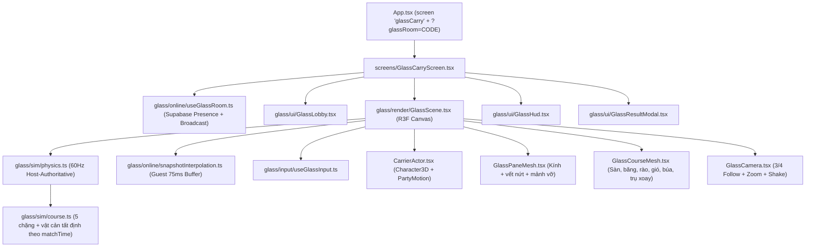

# Glass Carry Co-op — Design Spec (Minigame 4)

> Ngày: 2026-11-26.
> Chốt với người dùng: **chỉ chơi Online 2 người qua Supabase Realtime**, **3D góc nhìn 3/4 từ trên cao (tái sử dụng 8 thú bông 3D & 15 phụ kiện)**, **điều khiển Di chuyển + Nhảy + Nâng/Hạ kính**, **1 đường đua liên hoàn 5 chặng có Checkpoint (~3–5 phút)**, **Phương án A — Custom 3D Kinematics + Ràng buộc Kính (Host-Authoritative 60Hz, đồng bộ 15Hz)**.

---

## 1. Mục tiêu & Phạm vi

Hai người chơi cùng vào một phòng Online 2 người để điều khiển 2 thú bông 3D cùng khiêng một **tấm kính pha lê cỡ lớn** (`3.4m × 0.70m × 0.12m`) vượt qua cây cầu xưởng kính lơ lửng phong cách **Winter Cabin Skyway** gồm **5 chặng liên hoàn có Checkpoint**, đưa tấm kính về tới **Cổng Giao Kính** nhanh nhất với ít lần vỡ nhất.

### Có trong bản này
- **Chế độ chơi:** Online Co-op đúng **2 người** qua Supabase Realtime (`P1 = Host`, `P2 = Guest`), tạo phòng mã 6 ký tự, chia sẻ link mời `?glassRoom=CODE`, sảnh chờ có trạng thái Sẵn sàng.
- **Nhân vật & ngoại hình:** Tái sử dụng toàn bộ 8 nhân vật thú bông 3D (`Character3D`), 15 phụ kiện đang đeo từ `profileStore`, hoạt ảnh `PartyMotionState` (nghiêng chạy, nhảy, nâng/hạ tay cầm kính).
- **Điều khiển PC:**
  - `WASD` hoặc `Phím mũi tên`: Di chuyển 8 hướng.
  - `Space`: Nhảy (*coyote time* `100ms`, *jump buffer* `100ms`).
  - Giữ `E` hoặc `Chuột trái`: Nâng đầu kính bên mình lên cao (`+0.85m`).
  - Giữ `Q` hoặc `Chuột phải`: Hạ đầu kính bên mình xuống thấp (`-0.55m`).
  - `1`–`4`: Emote giao tiếp nhanh (`1: Chậm thôi!`, `2: Nhảy nào!`, `3: Nâng lên!`, `4: Hạ xuống!`).
- **Cơ chế vật lý tấm kính (Custom 3D Kinematics + Spring-Rod Constraint):**
  - Khoảng cách chuẩn `3.4m` (vùng an toàn `2.7m – 3.9m`); kéo giãn quá `3.9m` hoặc ép dưới `2.5m` sẽ tạo lực kéo lò xo đàn hồi + tăng thanh **Căng thẳng (Stress)** → đạt `100%` thì kính trượt tay vỡ.
  - Xoay ngang (`yaw`) tự do theo vector `P1 → P2` để xoay dọc tấm kính lách khe hẹp.
  - Nghiêng (`pitch`) theo chênh lệch độ cao 2 đầu tay; chênh lệch `> 1.8m` duy trì `> 0.6s` làm kính trượt vỡ.
  - **3 nấc độ bền (`HP = 3`):** `3` (trong suốt) → `2` (nứt nhẹ) → `1` (nứt chằng chịt + rung cảnh báo) → `0` (vỡ tan tành với ~28 mảnh kính 3D văng ra). Có *invulnerability* `0.7s` sau mỗi lần nứt để tránh trừ liên hoàn trong 1 pha va chạm.
- **Đường đua liên hoàn 5 chặng (~140m, 3–5 phút) có Checkpoint:**
  1. **Chặng 1 — Cổng Gỗ Khởi Động:** 2 cặp thanh chắn cao/thấp + 1 khe tường hẹp `2.2m`.
  2. **Chặng 2 — Sàn Băng & Quạt Gió:** Sàn băng ma sát thấp + 2 luồng gió ngang theo chu kỳ (có báo trước `1.5s`) + cọc chắn mép.
  3. **Chặng 3 — Xưởng Búa & Trụ Xoay:** 2 con lắc búa gỗ đung đưa + 1 trụ cánh quạt xoay ngang tầm thấp.
  4. **Chặng 4 — Cầu Bập Bênh & Bệ Nhảy:** Chuỗi bệ di chuyển ngang qua vực + cầu gỗ hẹp ngoằn ngoèo có cột đèn hai bên.
  5. **Chặng 5 — Nước Rút Về Đích:** Tổ hợp thanh chắn di chuyển chậm + gió nhẹ + bậc nhảy cuối tới Cổng Giao Kính.
  - Qua Checkpoint: đèn lồng bật sáng, phát SFX, tự động hồi kính về `3/3 HP`.
  - Vỡ kính hoặc 1 trong 2 người rơi vực (`y < -5`): hiệu ứng vỡ kính `1.2s`, cộng `shatters + 1`, cả 2 hồi sinh tức thì tại Checkpoint gần nhất.
- **Chấm điểm Sao, Kỷ lục & Cookies:**
  - `3★`: `elapsedSec <= 180` và `shatters <= 2` → **+50 Cookies**
  - `2★`: `elapsedSec <= 300` và `shatters <= 6` → **+30 Cookies**
  - `1★`: Hoàn thành với mọi thông số còn lại → **+15 Cookies**
  - Lưu `glassBestTimeSec` và `glassBestStars` vào `profileStore` (cộng Cookies idempotent qua `settledMatchIds`).
- **Tích hợp Hub & Audio:**
  - Card chế độ thứ 4 **Glass Carry Co-op** trên `ModeSelectScreen` kèm banner 16:9 riêng (`public/banners/glass-carry-banner.webp` & `.jpg`).
  - Route lazy-loaded `'glassCarry'` trong `App.tsx` kèm `ModeErrorBoundary` và `ModeLoadingFallback`.
  - Bổ sung 4 âm thanh Web Audio trong `soundEngine.ts`: `glassCrack`, `glassShatter`, `checkpoint`, `glassLift`.

### Ngoài phạm vi (Không có trong bản này)
- Chơi Solo cùng Bot AI hoặc Local 2 người chung 1 bàn phím.
- Điều khiển cảm ứng Mobile/Touch.
- Nhiều map lựa chọn hoặc chế độ Endless.
- Dùng `@react-three/rapier` cho minigame này (giữ engine thuần TypeScript để tránh nổ joint qua mạng và dễ test).
- Voice chat tích hợp (chỉ dùng Emote nhanh `1–4`).

---

## 2. Kiến trúc Module & Luồng Dữ Liệu

### Danh sách file mới trong `src/glass/`

| File | Trách nhiệm |
|---|---|
| `src/glass/sim/types.ts` | Toàn bộ kiểu dữ liệu thuần cho mô phỏng, chướng ngại vật, input, snapshot và sự kiện. |
| `src/glass/sim/constants.ts` | Hằng số vật lý, kích thước tấm kính, ngưỡng stress, invulnerability, bảng sao & thưởng Cookies. |
| `src/glass/sim/course.ts` | Định nghĩa 5 chặng đường đua, 5 Checkpoint, Cổng Đích, cùng hàm thuần `evaluateDynamicObstacles(course, matchTime)` tính vị trí bệ di chuyển / góc búa / góc trụ xoay / pha quạt gió từ `matchTime`. |
| `src/glass/sim/physics.ts` | Hàm thuần `createInitialSimState()` và `stepGlassSim(state, hostInput, guestInput, dt)`: cập nhật di chuyển, ma sát gỗ/băng, lực gió, nhảy, ràng buộc kính, va chạm OBB kính–vật cản, trừ HP/vỡ kính, hồi sinh checkpoint, về đích. |
| `src/glass/sim/scoring.ts` | Hàm thuần `calculateGlassResult(elapsedSec, shatters)` trả về `{ stars, cookies }` và helper kiểm tra kỷ lục mới. |
| `src/glass/online/protocol.ts` | Hằng số kênh, payload Presence & Broadcast (`glass:start`, `glass:input`, `glass:snapshot`, `glass:emote`, `glass:restart`, `glass:return_lobby`, `glass:sync_request`, `glass:sync_state`). |
| `src/glass/online/snapshotInterpolation.ts` | Bộ đệm snapshot phía Guest: lưu tối đa 4 snapshot gần nhất, nội suy tuyến tính vị trí/chiều cao và nội suy góc (`lerpAngle`) ở thời điểm `renderTime = now - 75ms`, tránh giật khi gói đến không đều. |
| `src/glass/online/useGlassRoom.ts` | Quản lý vòng đời phòng 2 người qua Supabase Realtime: tạo/vào mã phòng 6 ký tự, khóa tối đa 2 slot (`room_full` nếu người thứ 3 vào), đồng bộ trạng thái Sẵn sàng, phát/nhận input & snapshot 15Hz, xử lý rớt mạng grace `8s`. |
| `src/glass/input/useGlassInput.ts` | Hook lắng nghe bàn phím (`WASD`/Arrows, `Space`, `Q`, `E`, `1–4`) và chuột (trái = nâng, phải = hạ, chặn contextmenu trong canvas). |
| `src/glass/render/GlassScene.tsx` | `<Canvas>`, ánh sáng Winter Cabin, vòng lặp `useFrame` (Host chạy fixed timestep 60Hz + broadcast 15Hz; Guest gửi input 15Hz + đọc `snapshotInterpolation`), cập nhật HUD ~10Hz. |
| `src/glass/render/CarrierActor.tsx` | Render `<Character3D />` kèm `BrawlMotionContext` (tái sử dụng `PartyMotionState`), vòng chân màu P1/P2, nhãn tên và bong bóng emote 3D (`<Html>` hoặc billboard). |
| `src/glass/render/GlassPaneMesh.tsx` | Tấm kính `MeshPhysicalMaterial`, viền khung đổi màu theo `stress`, tay cầm 2 đầu, `CanvasTexture` vết nứt theo `hp` (3/2/1), và hệ thống 28 mảnh vỡ 3D văng khi vỡ. |
| `src/glass/render/GlassCourseMesh.tsx` | Render toàn bộ 5 chặng, sàn gỗ/băng, rào cao/thấp kẻ sọc + bóng chiếu xuống sàn, búa lắc, trụ xoay, bệ di chuyển, luồng hạt gió tuyết, cột cờ đèn lồng Checkpoint và Cổng Đích. |
| `src/glass/render/GlassCamera.tsx` | Camera 3/4 bám mượt trung điểm P1 & P2, `lookAhead` theo hướng tiến đường đua (`+Z`), tự zoom theo khoảng cách 2 người, cộng hiệu ứng rung khi nứt/vỡ. |
| `src/glass/ui/GlassLobby.tsx` | Màn tạo/vào phòng 2 người, copy link mời `?glassRoom=CODE`, thẻ 2 người chơi + trạng thái Sẵn sàng, bảng hướng dẫn phím tắt trực quan. |
| `src/glass/ui/GlassHud.tsx` | Thanh tiến trình 5 chặng, đồng hồ, số lần vỡ, 3 icon độ bền kính, thanh độ căng cảnh báo, nhắc phím tắt & 4 nút emote nhanh. |
| `src/glass/ui/GlassResultModal.tsx` | Modal về đích hiển thị 1–3★, tổng thời gian, số lần vỡ, Cookies thưởng, huy hiệu Kỷ lục mới, nút Chơi lại (Host) & Về chọn chế độ. |
| `src/screens/GlassCarryScreen.tsx` | Ghép toàn bộ `useGlassRoom` + `GlassScene` + `GlassLobby` / `GlassHud` / `GlassResultModal` + gọi `recordGlassMatchResult` một lần khi hoàn thành. |

### Tích hợp vào các file hiện có
- `src/App.tsx`: Thêm screen `'glassCarry'`, lazy import `GlassCarryScreen`, đọc `?glassRoom=` lúc khởi động và xóa query parameter sau khi nạp (y hệt `bbRoom`).
- `src/screens/ModeSelectScreen.tsx`: Thêm thẻ chế độ thứ 4 **Glass Carry Co-op**, bố cục lưới responsive 4 thẻ (`grid-cols-1 md:grid-cols-2 xl:grid-cols-4`), hiển thị kỷ lục sao / thời gian nhanh nhất.
- `src/store/profileSchema.ts` & `src/store/profileStore.ts`: Thêm `glassBestTimeSec: number | null`, `glassBestStars: number` và hàm `recordGlassMatchResult(matchId, elapsedSec, shatters)` với chống cộng trùng qua `settledMatchIds`.
- `src/audio/soundEngine.ts`: Thêm `glassCrack`, `glassShatter`, `checkpoint`, `glassLift`.
- `public/banners/glass-carry-banner.webp` & `.jpg`: Banner key-art 16:9 đồng bộ phong cách 3 banner hiện có.

---

## 3. Chi tiết Mô phỏng Vật lý & Tấm Kính

### Hệ tọa độ thống nhất
- Đường đua trải dài theo trục **`+Z`** từ `z = 0` (Xuất phát) tới `z = 140` (Cổng Đích).
- Trục **`X`** là chiều ngang đường đua (`-X` trái, `+X` phải); trục **`Y`** là độ cao (`y = 0` là mặt sàn chuẩn).

### Quy tắc bước mô phỏng 60Hz (`dt = 1/60`)
1. **Di chuyển nhân vật (`P1`, `P2`):**
   - Tốc độ tối đa trên sàn gỗ: `5.4 m/s`, gia tốc nhanh, giảm tốc mượt.
   - Trên **sàn băng** (`surface === 'ice'`): gia tốc thấp hơn (`35%`) và lực hãm thấp (`15%`) tạo cảm giác trượt quán tính vui nhộn nhưng vẫn kiểm soát được.
   - Trong vùng **quạt gió** (khi chu kỳ gió bật): cộng thêm lực đẩy ngang `windForceX` lên nhân vật đang đứng trong vùng gió.
   - Nhảy: vận tốc lên `vy = 7.6 m/s`, trọng lực `g = -20 m/s²`, hỗ trợ *coyote time* `0.1s` và *jump buffer* `0.1s`.
   - Độ cao tay cầm kính của từng nhân vật: `handY = player.y + 0.95 + liftOffset`, trong đó `liftOffset` nội suy mượt (`speed = 9/s`) tới `+0.85m` (nâng), `0m` (thường), hoặc `-0.55m` (hạ).
2. **Ràng buộc lò xo–dây tấm kính:**
   - Vector nối 2 tay theo mặt phẳng ngang `dx = p2.x - p1.x`, `dz = p2.z - p1.z`, `dist = hypot(dx, dz)`.
   - Nếu `dist > 3.9m`: áp lực kéo hướng vào nhau tỉ lệ `(dist - 3.9)` lên cả 2 nhân vật; đồng thời `stress += (dist - 3.9) * 0.95 * dt`.
   - Nếu `dist < 2.5m`: áp lực đẩy nhẹ tách ra để tránh chồng lên nhau; `stress += (2.5 - dist) * 0.85 * dt`.
   - Nếu `|handY2 - handY1| > 1.8m`: `stress += 1.65 * dt` (quá `~0.6s` thì đầy `stress = 1`).
   - Khi ở vùng an toàn (`2.6m ≤ dist ≤ 3.85m` và `|ΔhandY| ≤ 1.6m`): `stress` hồi giảm về `0` với tốc độ `0.8/s`.
   - Nếu `stress >= 1.0` hoặc `dist > 4.9m`: kích hoạt vỡ kính (`reason: 'stretch'`).
3. **Va chạm OBB tấm kính với chướng ngại vật:**
   - Tấm kính được biểu diễn bởi 5 điểm mẫu dọc theo thanh kính từ tay P1 đến tay P2 (độ dày `0.12m`, chiều cao thân kính `0.70m`, tức `±0.35m` quanh `handY`):
     - Khi **Hạ (`Q`)**: `handY = 0.40m` → thân kính nằm trong `y ∈ [0.05, 0.75]` (nhân vật cũng cúi thấp còn `0.85m`).
     - Khi **Thường**: `handY = 0.95m` → thân kính nằm trong `y ∈ [0.60, 1.30]`.
     - Khi **Nâng (`E`)**: `handY = 1.80m` → thân kính nằm trong `y ∈ [1.45, 2.15]`.
   - Mỗi vật cản được kiểm tra va chạm giao với đoạn kính 3D:
     - **Rào chắn cao (`lowGap`, treo ngang cầu ở `y ∈ [0.95, 2.60]`):** Kính ở tư thế thường hoặc nâng sẽ chạm; cả 2 **hạ kính (`Q`)** xuống `y ≤ 0.75` sẽ lọt êm qua gầm (dư `0.20m` an toàn).
     - **Rào chắn thấp giữa làn (`highWall`, dải trụ/rào đặt dọc trục giữa cầu ở `y ∈ [0, 1.25]`, 2 bên vẫn đủ lối cho P1 & P2 bước qua):** Kính ở tư thế thường hoặc hạ sẽ chạm; cả 2 **nâng kính (`E`)** lên `y ≥ 1.45` sẽ đưa tấm kính vượt gọn phía trên (dư `0.20m` an toàn).
     - **Khe hẹp (2 bức tường để hở `2.2m`):** Kính dài `3.4m` đi ngang sẽ đụng tường; 2 người xoay dọc kính (`|dx| < 1.5m`) đi nối đuôi sẽ lọt qua dễ dàng.
     - **Búa lắc & trụ xoay:** Va chạm mạnh trừ `2 HP` (hoặc vỡ ngay nếu đang còn `≤ 2 HP`) kèm bật ngược nhẹ.
   - Sau khi kính mất HP mà vẫn còn `hp > 0`, kích hoạt `invulnTimer = 0.7s` để không bị trừ tiếp trong cùng 1 pha chạm.
4. **Vỡ kính & Hồi sinh Checkpoint:**
   - Khi `hp <= 0` hoặc `p1.y < -5` hoặc `p2.y < -5`: chuyển `shatterTimer = 1.2s`, phát sự kiện `'glass_shatter'`, tăng `shatters += 1`, khóa input trong `1.2s` để xem mảnh kính vỡ văng.
   - Hết `1.2s`: đặt lại P1 & P2 tại vị trí spawn của `checkpointIndex` hiện tại (đứng ngang cách nhau `3.2m`), `hp = 3`, `stress = 0`, `invulnTimer = 1.0s`, phát sự kiện `'respawn'`.
5. **Checkpoint & Về Đích:**
   - Khi cả P1 và P2 có `z >= checkpoint.z` và kính chưa vỡ: cập nhật `checkpointIndex`, hồi `hp = 3`, `stress = 0`, phát sự kiện `'checkpoint'`.
   - Khi cả P1 và P2 vượt qua `z >= finishZ` (`140m`) với `hp > 0`: chuyển `phase = 'finished'`, đóng băng `elapsedSec`, phát sự kiện `'course_clear'`.

---

## 4. Đồng bộ Mạng & Xử lý Lỗi / Biên

- **Giới hạn 15Hz của Supabase Realtime (`eventsPerSecond: 15`):**
  - Guest throttle `glass:input` tối đa 15 gói/giây (nhưng gửi ngay lập tức khi có thay đổi phím nhấn nếu đã qua `>= 66ms`, đảm bảo cảm giác phản hồi nhanh).
  - Host phát `glass:snapshot` ở chu kỳ cố định `67ms` (~15Hz), payload số học làm tròn 2 chữ số thập phân để giữ kích thước gói `< 180 bytes`.
- **Phòng chỉ tối đa 2 người:**
  - Khi người thứ 3 join kênh có sẵn 2 thành viên Presence hoạt động, hook tự nhận diện không nằm trong 2 `peerId` có `joinedAt` nhỏ nhất → ngắt kết nối an toàn và hiển thị trạng thái `Phòng đã đủ 2 người`.
- **Mất kết nối & Grace Timeout (`8s`):**
  - Nếu 1 trong 2 người rời Presence trong lúc `playing`, máy còn lại tạm dừng mô phỏng và hiện banner `"Đang chờ đồng đội kết nối lại... (8s)"`.
  - Nếu đồng đội quay lại trong `8s` (tự động gửi `glass:sync_request` → Host gửi `glass:sync_state`), trận tiếp tục ngay tại vị trí hiện tại.
  - Sau `8s` vẫn mất kết nối: hiện thông báo kết thúc phòng với nút về sảnh chờ / chọn chế độ.
- **Mất gói input từ Guest (`> 400ms`):**
  - Host tự đặt `moveX = 0, moveZ = 0, jump = false` cho Guest (giữ nguyên `lift` cuối cùng) để nhân vật Guest đứng yên thay vì trôi theo hướng cũ xuống vực.
- **Thiếu cấu hình Supabase:**
  - Kiểm tra `isSupabaseConfigured()` ngay khi mở `GlassCarryScreen`; nếu chưa cấu hình, hiện thẻ hướng dẫn thân thiện trỏ tới `SUPABASE_SETUP.md` và nút quay lại `ModeSelectScreen`.
- **Tab bị ẩn (`visibilitychange`):**
  - Luôn giới hạn `dt = Math.min(rawDt, 0.05)` trong `useFrame` để không bao giờ nhảy xuyên sàn/chướng ngại vật khi quay lại tab.

---

## 5. Kế hoạch Kiểm chứng

1. **Unit Tests (thuần TypeScript với `node --test --experimental-strip-types`, giống `src/engine/__tests__/` và `src/blockblast/engine/__tests__/`):**
   - `src/glass/sim/__tests__/physics.test.ts`:
     - Di chuyển, nhảy + coyote time, trượt băng, lực đẩy quạt gió.
     - Ràng buộc lò xo kính: kéo quá `3.9m` làm tăng stress và vỡ kính; giữ an toàn thì hồi stress.
     - Va chạm rào cao (hạ kính qua được, giữ thường/nâng bị nứt), rào thấp (nâng kính qua được, hạ bị nứt), khe hẹp (đi ngang bị cản, xoay dọc qua được).
     - Invulnerability `0.7s` ngăn trừ liên hoàn nhiều HP trong 1 chạm.
     - Checkpoint hồi `hp = 3`; rơi vực hồi sinh về Checkpoint và tăng `shatters`.
   - `src/glass/sim/__tests__/scoring.test.ts`:
     - Kiểm tra đầy đủ biên `3★` (`<= 180s`, `<= 2` vỡ), `2★` (`<= 300s`, `<= 6` vỡ), `1★`, thưởng Cookies và so sánh kỷ lục mới.
   - `src/glass/online/__tests__/snapshotInterpolation.test.ts`:
     - Nội suy vị trí mượt, nội suy góc `lerpAngle` qua biên `-π / +π` không bị xoay ngược vòng, fallback an toàn khi mới nhận 1 snapshot.
   - Cập nhật `src/store/__tests__/profileStore.test.ts`:
     - Kiểm tra `recordGlassMatchResult` cập nhật `glassBestTimeSec` / `glassBestStars` và chống cộng trùng Cookies theo `matchId`.
2. **Typecheck & Production Build:**
   - `npm run typecheck` (`tsc --noEmit`) và `npm run build` đều xanh 0 lỗi.
3. **Kiểm thử trên trình duyệt:**
   - Khởi động dev server, kiểm tra card thứ 4 trên `ModeSelectScreen` (ảnh banner, layout 4 cột responsive, không tràn khung).
   - Kiểm tra vào `GlassCarryScreen`, luồng phòng chờ tạo/nhập mã, copy link mời `?glassRoom=...`, kiểm tra render 3D và console không lỗi runtime.
