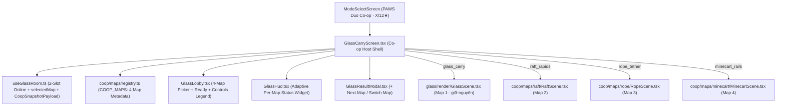

# PAWS Duo Co-op 3D (4 Maps) — Design Spec

> Ngày: 2026-11-26.
> Chốt với người dùng: **mở rộng chế độ Co-op 2 người Online hiện tại thành bộ 4 Map có cơ chế hợp tác khác hẳn nhau** (**Bê Kính Pha Lê** + **Chèo Phao Vượt Thác** + **Dây Thừng Buộc Chung** + **Xe Goòng Đường Ray**), **1 phòng chờ chung 2 người (Chủ phòng P1 chọn & đổi Map thoải mái giữa các ván)**, **mỗi Map gồm 5 chặng liên hoàn có Checkpoint (~2.5–4 phút)**, **chấm 1–3★ & Cookies + lưu kỷ lục riêng từng Map (tổng tối đa 12★)**, **Phương án A — Shared Online Room + Pluggable Map Registry**.

---

## 1. Mục tiêu & Phạm vi

Biến minigame **Glass Carry Co-op** thành hệ thống **PAWS Duo Co-op 3D (4 Map)** cho 2 người chơi Online qua Supabase Realtime, trong đó mỗi Map sở hữu **một kiểu cơ chế hợp tác vật lý hoàn toàn khác biệt**, dùng chung 8 nhân vật thú bông 3D, 15 phụ kiện, phòng chờ 2 người, hệ thống Emote, Checkpoint và ví Cookies.

### Có trong bản này
- **4 Map hợp tác (mỗi map 5 chặng liên hoàn + 5 Checkpoint):**
  1. **Map 1 (`glass_carry`) — Bê Kính Pha Lê** *(giữ nguyên engine & 36 unit tests hiện tại trong `src/glass/sim/`)*.
  2. **Map 2 (`raft_rapids`) — Chèo Phao Vượt Thác (`160m`):** 2 người ngồi trên 1 phao bơm hơi lao xuống sông băng; P1 chèo Trái, P2 chèo Phải, chèo đồng nhịp kích hoạt **Boost Lướt Sóng**, nghiêng người lách xoáy nước & nhún `Space` đồng bộ vượt khúc gỗ/thác.
  3. **Map 3 (`rope_tether`) — Dây Thừng Buộc Chung (`135m`):** 2 người buộc chung bằng sợi dây thừng đàn hồi `4.5m` vượt chuỗi đảo băng nâng cao; giữ `Q` để **Cắm Neo Chân** giữ đồng đội đang treo dưới vực, giữ `E` để **Kéo Dây** ròng rọc kéo đồng đội lên đảo, và phối hợp **Đu Văng** qua vực rộng.
  4. **Map 4 (`minecart_rails`) — Xe Goòng Đường Ray (`180m`):** 2 người đứng trên 1 xe goòng bập bênh chạy trên **3 làn ray song song**; luân phiên bấm `E` theo lượt P1↔P2 để **Bơm Tăng Tốc**, cùng nghiêng `A`/`D` để **Đổi Làn Ray**, cùng giữ `Q` để **Cúi Né Xà Ngang**, cùng bấm `Space` để **Nhảy Cầu Ray Gãy**.
- **1 Phòng Online 2 Người Dùng Chung (`useGlassRoom` nâng cấp đa Map):**
  - Chủ phòng (`P1`) chọn/đổi Map trực tiếp trong sảnh chờ (`coop:select_map`); đổi Map sẽ tự reset trạng thái Sẵn sàng để cả 2 xem hướng dẫn phím tắt mới.
  - Hỗ trợ cả link mời `?coopRoom=CODE` và `?glassRoom=CODE` (tương thích ngược).
  - Modal kết quả có nút **Chơi Map Tiếp Theo**, **Chơi Lại**, và **Về Sảnh Đổi Map** (không cần tạo lại phòng).
- **Kỷ lục 12★ & Cookies (`profileStore`):**
  - Lưu `coopRecords: Partial<Record<CoopMapId, { bestStars: number; bestTimeSec: number }>>` (tự động migrate `glassBestStars`/`glassBestTimeSec` cũ sang `coopRecords.glass_carry`, vẫn giữ đồng bộ 2 field cũ).
  - Thang thưởng chuẩn trên cả 4 Map: `3★ → +50 Cookies`, `2★ → +30 Cookies`, `1★ → +15 Cookies` (cộng idempotent qua `settledMatchIds`).
- **Âm thanh bổ sung (`soundEngine.ts`):** `paddleSplash`, `raftBoost`, `ropePull`, `cartClack`.
- **Cập nhật Hub (`ModeSelectScreen.tsx`):** Thẻ thứ 4 nâng cấp thành **PAWS Duo Co-op 3D** hiển thị tổng sao (`X / 12★`) và mô tả 4 kiểu hợp tác.

### Ngoài phạm vi
- Không thêm dependency npm mới.
- Không thêm chế độ Solo Bot, Local 2 người 1 máy, hay điều khiển Mobile/Touch.
- Không sửa đổi cơ chế vật lý lõi của Map 1 (`src/glass/sim/physics.ts`, `course.ts`) ngoài việc giữ nguyên toàn bộ test xanh.

---

## 2. Kiến trúc Module (`src/coop/` + `src/glass/`)

### Bảng phân rã file mới & chỉnh sửa

| File / Thư mục | Trách nhiệm |
|---|---|
| `src/coop/maps/registry.ts` | Kiểu `CoopMapId`, `CoopMapMeta`, mảng `COOP_MAPS` (4 map), `getCoopMapMeta(id)`, `getNextCoopMapId(id)`, `calculateCoopResult(mapId, elapsedSec, failures)`, `countTotalCoopStars(records)`. |
| `src/coop/maps/raft/types.ts` | Kiểu dữ liệu Map 2: `RaftSimState`, `RaftCourseDef`, `RaftObstacleEval`, `RaftSnapshotPayload`, `RaftSimEvent`. |
| `src/coop/maps/raft/course.ts` | 5 chặng sông băng `160m`, 5 Checkpoint (`z = 0, 32, 64, 96, 128`), đá ngầm, khúc gỗ trôi ngang, xoáy nước hút lệch, dòng xiết & Cổng Phao Đích (`finishZ = 160`). |
| `src/coop/maps/raft/physics.ts` | Engine 60Hz thuần TypeScript: lực đẩy dòng chảy, chèo Trái/Phải (`0.35s` cooldown), đồng nhịp Boost (`≤ 0.25s`), nghiêng trọng tâm, nhún nhảy phao (`Space` đồng bộ `≤ 0.30s`), va chạm đá/gỗ/xoáy, 3 HP + `0.8s` bất tử, hồi sinh Checkpoint. |
| `src/coop/maps/raft/RaftScene.tsx` | Cảnh 3D sông băng R3F: phao bơm hơi + 2 thú bông cầm mái chèo vung động + bọt nước Boost + đá/gỗ/xoáy/checkpoint + Host 60Hz / Guest 75ms interpolation. |
| `src/coop/maps/rope/types.ts` | Kiểu dữ liệu Map 3: `RopeSimState`, `RopeCourseDef`, `RopeSnapshotPayload`, `RopeSimEvent`. |
| `src/coop/maps/rope/course.ts` | 5 chặng chuỗi đảo tuyết nâng độ cao `135m` (`y = 0 → +4.5m`), 5 Checkpoint (`z = 0, 27, 54, 81, 108`), đảo băng gió hất, búa lắc, bệ di chuyển, Đỉnh Tháp Đèn Lồng (`finishZ = 135`). |
| `src/coop/maps/rope/physics.ts` | Engine 60Hz thuần TypeScript: ràng buộc dây đàn hồi `4.5m`, Cắm Neo (`Q`, khóa trượt & chịu tải gấp 10× giữ người treo dưới vực), Kéo Dây (`E`, ròng rọc kéo người treo lên), thanh chịu lực dây `ropeStrain` (`0..1`), thất bại khi cả 2 rơi `< -6` hoặc đứt dây. |
| `src/coop/maps/rope/RopeScene.tsx` | Cảnh 3D chuỗi đảo R3F: 2 thú bông + dây thừng cong catenary 10 đốt đổi màu theo lực căng + vòng khóa Neo + hiệu ứng kéo dây + đảo leo cao. |
| `src/coop/maps/minecart/types.ts` | Kiểu dữ liệu Map 4: `MinecartSimState`, `MinecartCourseDef`, `MinecartSnapshotPayload`, `MinecartSimEvent`. |
| `src/coop/maps/minecart/course.ts` | 5 chặng 3 làn ray `180m` (`lane 0: x = +3.2`, `lane 1: x = 0`, `lane 2: x = -3.2`), 5 Checkpoint (`z = 0, 36, 72, 108, 144`), chướng ngại vật trên làn, xà gỗ thấp `y ∈ [1.15, 2.5]`, cầu ray gãy (`4.8m` gap), đá lở báo trước & Ga Đích (`finishZ = 180`). |
| `src/coop/maps/minecart/physics.ts` | Engine 60Hz thuần TypeScript: bơm tay luân phiên `pumpTurn` (`p1 ↔ p2`), tốc độ `3.5..13.5 m/s`, nghiêng đồng bộ `A`/`D` đổi 3 làn (nghiêng ngược lắc tại chỗ), cúi đồng bộ `Q` né xà ngang, nhảy đồng bộ `Space` vượt cầu gãy (cần tốc độ `≥ 7.0 m/s`), 3 HP + `0.8s` bất tử. |
| `src/coop/maps/minecart/MinecartScene.tsx` | Cảnh 3D đường ray mỏ băng R3F: xe goòng bập bênh có cần bơm đổi sáng theo lượt P1/P2 + 3 đường ray + hầm xà sọc vàng-đen + biển đèn báo đá lở + tia lửa chuyển ray. |
| `src/coop/online/coopInterpolation.ts` | Bộ nội suy `75ms` đa map (`CoopSnapshotInterpolator`) hỗ trợ `raft_rapids`, `rope_tether`, `minecart_rails` (tự reset khi đổi `matchId`/`mapId`). |
| `src/glass/online/protocol.ts` & `useGlassRoom.ts` | Bổ sung `selectedMap: CoopMapId`, `selectMap(mapId)`, `startNextMap()`, discriminated union `CoopSnapshotPayload` (tương thích 100% với `GlassSnapshotPayload`), đồng bộ map qua Presence & Broadcast `coop:select_map`. |
| `src/glass/render/renderTypes.ts` | Mở rộng `GlassHudSnapshot` (thêm trường hiển thị động nhẹ cho 4 map: `mapId`, `primaryMeterPct`, `primaryMeterLabel`, `statusBadge`, `pumpTurn`, `boostActive`, `anchoredSlots`). |
| `src/glass/ui/GlassLobby.tsx`, `GlassHud.tsx`, `GlassResultModal.tsx`, `src/screens/GlassCarryScreen.tsx` | 4-Map Picker trong sảnh, bảng phím tắt đổi theo Map, HUD thích ứng 4 map, nút **Map Tiếp Theo** & điều phối 4 Scene 3D. |
| `src/store/profileSchema.ts`, `profileStore.ts`, `src/audio/soundEngine.ts`, `src/screens/ModeSelectScreen.tsx`, `src/App.tsx` | Lưu `coopRecords` (12★ + migrate `glassBest*`), 4 SFX mới, thẻ Hub `PAWS Duo Co-op 3D`, hỗ trợ `?coopRoom=` & `?glassRoom=`. |

---

## 3. Chi tiết Vật lý & Hệ Tọa Độ Thống Nhất (Cả 4 Map)

Tất cả 4 map dùng chung hệ tọa độ right-handed nhìn xuôi theo **`+Z`**:
- Camera đặt phía sau (`-Z`) nhìn về phía trước (`+Z`), do đó **bên trái màn hình là `+X`** (`A`/`ArrowLeft` → `moveX = +1`), **bên phải màn hình là `-X`** (`D`/`ArrowRight` → `moveX = -1`).

### Map 2: Chèo Phao Vượt Thác (`raft_rapids`)
- **Phạm vi sông:** `z ∈ [0, 160]`, bề rộng `x ∈ [-6.5, +6.5]`, bán kính va chạm phao `R = 1.25m`, mặt nước `y = 0`.
- **Input mapping từ `PlayerInput`:**
  - `strokeForward = input.lift > 0 || input.moveZ > 0.35` (cooldown `0.35s` mỗi người).
  - `strokeBack = input.lift < 0 || input.moveZ < -0.35` (cooldown `0.35s`).
  - `leanX = input.moveX` (nghiêng người dồn trọng tâm, lực trượt ngang nhẹ).
  - `jump = input.jump` (cả 2 bấm trong cửa sổ `0.30s` khi phao ở mặt nước → `vy = 8.4`, bay qua khúc gỗ `y ∈ [0, 0.75]`).
- **Động lực học chèo:**
  - Dòng nước tự đẩy nhẹ theo `+Z` (`baseCurrentZ = 2.6 m/s`, tăng lên `4.2 m/s` ở Chặng 4 Thác Ghềnh).
  - **P1 ngồi mạn Trái (`+X`):** quẫy tới đẩy phao tiến (`+2.4 m/s`) và xoay mũi sang Phải (`yaw -= 0.42 rad`); quẫy ngược xoay mũi sang Trái (`yaw += 0.38 rad`).
  - **P2 ngồi mạn Phải (`-X`):** quẫy tới đẩy phao tiến (`+2.4 m/s`) và xoay mũi sang Trái (`yaw += 0.42 rad`); quẫy ngược xoay mũi sang Phải (`yaw -= 0.38 rad`).
  - **Đồng nhịp Boost (`|lastP1StrokeTime - lastP2StrokeTime| <= 0.25s`):** triệt tiêu góc lệch xoay, bật `boostTimer = 1.1s` (cộng lực tiến `+3.5 m/s` và phát `'raft_boost'`).
- **Chướng ngại & sát thương:** Đá ngầm (`rock`), khúc gỗ nổi (`log`, nhảy `y > 0.78` thì qua êm), vùng xoáy nước (`whirlpool`, hút xoắn vào tâm & xoay góc). Đâm đá/gỗ trừ `1 HP` (bật ngược nhẹ + `0.8s` bất tử); hết `3 HP` → vỡ bọt hồi sinh tại Checkpoint (`1.1s` lock, `failures + 1`).
- **Ngưỡng sao:** `3★`: `≤ 140s` & `≤ 2` hỏng; `2★`: `≤ 240s` & `≤ 6` hỏng.

### Map 3: Dây Thừng Buộc Chung (`rope_tether`)
- **Phạm vi đường đua:** `z ∈ [0, 135]`, 5 chặng nâng dần độ cao từ `y = 0` lên `y = 4.5` tại Đỉnh Tháp Đèn Lồng.
- **Input mapping từ `PlayerInput`:**
  - `WASD` + `Space`: di chuyển & nhảy (`vy = 7.8`, trọng lực `-20`).
  - `anchor = input.lift < 0` (`Q` / Chuột phải, chỉ kích hoạt khi đang chạm sàn `grounded`): khóa trượt ngang (ma sát ×5, trọng số khối lượng `10:1` trong bộ giải dây) để đứng vững giữ đồng đội.
  - `reelIn = input.lift > 0` (`E` / Chuột trái, khi `grounded`): thu ngắn chiều dài dây mục tiêu về `1.2m` ở tốc độ `3.4 m/s`, kéo đồng đội đang treo dưới vực lên cao (`vy` tăng dần + kéo ngang về phía người kéo) và phát `'rope_pull'`.
- **Ràng buộc dây (`ROPE_MAX_LEN = 4.5m`):**
  - Khi khoảng cách 3D `dist > effectiveLen`: phân bổ lực kéo theo tỉ lệ khối lượng nghịch đảo (`w = 0.08` nếu đang Cắm Neo, `w = 1.0` nếu đang tự do/rơi). Nhờ đó, 1 người Cắm Neo trên đảo giữ được hoàn toàn người kia đang treo lơ lửng (`y < islandY`), tạo cơ chế cứu hộ & đu văng đích thực!
  - Nếu người đang treo lơ lửng (`y < partner.y - 1.5` và `!grounded`) quá lâu → `ropeStrain` tăng (`+0.15/s`, tức có `~6.5s` để đồng đội kéo lên); khi cả 2 đứng an toàn trên sàn → `ropeStrain` hồi nhanh (`-0.6/s`).
- **Thất bại & Hồi sinh:** Khi **cả 2 đều rơi dưới `y < -6`** hoặc `ropeStrain >= 1.0` hoặc va búa lắc lúc đang căng → đứt dây (`1.2s` lock, `failures + 1`) và hồi sinh cả 2 tại Checkpoint gần nhất.
- **Ngưỡng sao:** `3★`: `≤ 180s` & `≤ 2` lần đứt/rơi; `2★`: `≤ 300s` & `≤ 6` lần.

### Map 4: Xe Goòng Đường Ray (`minecart_rails`)
- **Phạm vi đường ray:** `z ∈ [0, 180]`, 3 làn ray cố định `LANE_X = [+3.2, 0, -3.2]` (`lane 0` Trái, `lane 1` Giữa, `lane 2` Phải).
- **Input mapping từ `PlayerInput`:**
  - **Bơm Tăng Tốc (`lift > 0`, bấm cạnh lên `E`/Chuột trái):** Khi đúng lượt `pumpTurn` (`p1` hoặc `p2`), đổi ngay `pumpTurn` sang người kia, cộng tốc độ `+2.8 m/s` (tối đa `13.5 m/s`, lực cản giảm chậm về nền `4.2 m/s`) và phát `'cart_pump'`.
  - **Đổi Làn Đồng Bộ (`moveX`):** Cả 2 cùng giữ Trái (`moveX > 0.4`, hướng `+X` → `lane - 1`) hoặc cùng giữ Phải (`moveX < -0.4`, hướng `-X` → `lane + 1`) liên tục `0.10s` (cooldown `0.32s`) → xe bật chuyển làn mượt! Nếu 2 người nghiêng ngược chiều → tăng `wobble` lắc xe vui nhộn nhưng giữ nguyên làn.
  - **Cúi Né Xà Ngang (`lift < 0`, `Q`/Chuột phải):** Khi xe đi qua xà gỗ thấp (`beam`, `y ∈ [1.15, 2.5]` trên làn hiện tại), nếu cả 2 cùng giữ `lift < 0` → qua êm; nếu 1 hoặc cả 2 quên cúi → `-1 HP` (`0.8s` bất tử).
  - **Nhảy Cầu Ray Gãy (`jump`, `Space`):** Cả 2 cùng bấm `Space` trong cửa sổ `0.30s` khi chạm ray → xe bật nhảy (`vy = 8.8`, trọng lực `-22`). Để bay qua hố ray gãy `4.8m` (thời gian bay `~0.80s`), xe cần tốc độ `≥ 7.0 m/s`! Nếu không nhảy hoặc thiếu đà → rơi hố (`y < -4`) → trật bánh hồi sinh tại Checkpoint (`1.1s` lock, `failures + 1`).
- **Độ bền xe (`3 HP`):** Đâm khối đá chắn làn (`blocker`), đá lở (`fallingRock`) hoặc cốc đầu xà ngang trừ `1 HP` (`0.8s` bất tử); hết `3 HP` → trật bánh hồi sinh Checkpoint (`failures + 1`). Qua Checkpoint hồi lại `3/3 HP`.
- **Ngưỡng sao:** `3★`: `≤ 145s` & `≤ 2` lần trật bánh; `2★`: `≤ 240s` & `≤ 6` lần.

---

## 4. Kế hoạch Kiểm chứng

1. **Unit Tests (`node --test --experimental-strip-types`):**
   - Toàn bộ 52 test cũ (`glass/sim`, `glass/online`, `profileStore`) giữ nguyên xanh 100%.
   - `src/coop/maps/registry.test.ts`: kiểm tra 4 map metadata, tính sao theo từng map, `getNextCoopMapId`, `countTotalCoopStars` (tối đa `12`).
   - `src/coop/maps/raft/__tests__/raftPhysics.test.ts`: chèo 1 bên xoay mũi, chèo đồng nhịp kích hoạt Boost, nhảy đồng bộ qua khúc gỗ, đâm đá trừ HP + `0.8s` invuln, xoáy nước đẩy lệch, checkpoint hồi HP & về đích `z >= 160`.
   - `src/coop/maps/rope/__tests__/ropePhysics.test.ts`: dây dài `4.5m` kéo đồng đội, Cắm Neo (`Q`) giữ được người rơi dưới vực, Kéo Dây (`E`) kéo người treo lên mặt đảo, cả 2 rơi dưới `-6` hoặc đứt dây mới respawn, checkpoint & về đích `z >= 135`.
   - `src/coop/maps/minecart/__tests__/minecartPhysics.test.ts`: bơm luân phiên `p1 ↔ p2` tăng tốc, nghiêng đồng bộ đổi 3 làn (nghiêng ngược giữ nguyên làn + wobble), cúi đồng bộ `Q` né xà ngang, nhảy đồng bộ `Space` với tốc độ `>= 7.0` qua cầu ray gãy `4.8m` (tốc độ thấp thì rơi), checkpoint hồi HP & về đích `z >= 180`.
   - `src/coop/online/__tests__/coopInterpolation.test.ts`: nội suy mượt cho `raft_rapids`, `rope_tether`, `minecart_rails` + tự reset khi đổi `matchId` hoặc `mapId`.
   - Mở rộng `src/store/__tests__/profileStore.test.ts`: kiểm tra `settleCoopMatch` cho cả 4 map, tổng 12★, migrate dữ liệu `glassBestStars`/`glassBestTimeSec` cũ sang `coopRecords.glass_carry`.
2. **Typecheck & Production Build:** `npm run build` (`tsc --noEmit && vite build`) pass 0 lỗi.
3. **Browser Smoke Check:** Kiểm tra thẻ Hub **PAWS Duo Co-op 3D** (`X / 12★`), vào phòng chờ tạo phòng Online, bấm đổi qua lại tất cả 4 Map (xác nhận tên map, mô tả, bảng phím tắt đổi đúng tức thì), kiểm tra link `?coopRoom=...` và `?glassRoom=...`, 0 lỗi console.
