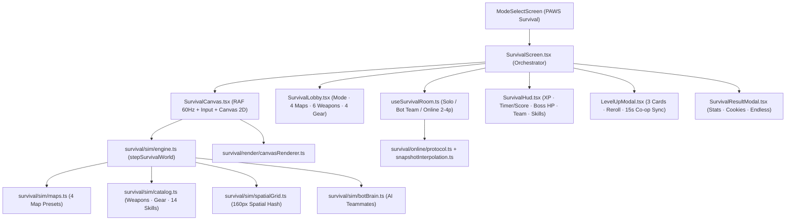

# PAWS Survival (Sinh Tồn 2D Top-Down) — Design Spec

> Ngày: 2026-11-27.
> Chốt với người dùng: **Phương án A — Host-Authoritative Pure TS Simulation + HTML5 Canvas 2D Renderer**, hỗ trợ **Solo + Team Bot AI (offline) + Team Online Co-op (2–4 người qua Supabase Realtime)**, **4 bản đồ `3600 × 3600 px`** (3 bản đồ Chiến dịch 6 phút với 3 mốc Boss + 1 bản đồ **Đấu Trường Vô Cực** để so kè điểm), **6 vũ khí chính + 4 trang bị khởi đầu** (mở sẵn toàn bộ), **bắn quái rớt ngọc XP -> lên cấp chọn 1 trong 3 kỹ năng** (14 kỹ năng gồm cả 4 vũ khí phụ tự động), **lai tự động ngắm bắn + tùy chọn ngắm chuột + Dash (`Space`)**.

---

## 1. Mục tiêu & Phạm vi

Xây dựng chế độ minigame **PAWS Survival** theo thể loại top-down action roguelite survival (kiểu *Brotato / Vampire Survivors*) trong hệ sinh thái `paws-game`, giữ trọn phong cách nhân vật thú bông PAWS, ví **Cookies** và kiến trúc tách biệt `sim / render / online / ui`.

### Có trong bản này
- **3 hình thức chơi trên cùng 1 engine:**
  - **Solo (Offline):** 1 người chơi sinh tồn đơn độc.
  - **Team Bot AI (Offline):** 1 người chơi + `1–3` đồng đội thú bông Bot AI tự di chuyển, né đòn, bắn quái, nhặt XP và chạy lại cứu người chơi khi gục.
  - **Team Online Co-op (2–4 người qua Supabase Realtime):** Tạo/vào phòng bằng mã 6 ký tự (hỗ trợ link mời `?survivalRoom=CODE`), Host chạy simulation 60Hz và phát snapshot 15–20Hz, khách gửi input 20Hz; có **bể XP chung (Shared Team XP)** và **Tạm dừng đồng bộ lên cấp (tối đa 15 giây)**.
- **4 Bản đồ lớn (`3600 × 3600 px`):**
  1. `winter_cabin` — **Rừng Tuyết Cabin** *(Chiến dịch 6 phút, cân bằng)*: Sàn băng trượt tăng `+18%` tốc chạy.
  2. `candy_canyon` — **Hoang Mạc Kẹo Đá** *(Chiến dịch 6 phút, thoáng)*: Bão cát định kỳ 75s tạo lực gió nhẹ & tăng tần suất hòm tiếp tế.
  3. `crystal_cavern` — **Hầm Mỏ Pha Lê** *(Chiến dịch 6 phút, chiến thuật)*: Trụ Pha Lê Năng Lượng kích hoạt hào quang `+20%` tốc độ bắn 10s (hồi 30s).
  4. `endless_abyss` — **Đấu Trường Vô Cực** *(Vô tận · So kè điểm)*: Không giới hạn thời gian, Boss xoay vòng mỗi **90 giây** với hệ số máu/điểm tăng liên tục, lưu kỷ lục điểm cao nhất & bảng xếp hạng đóng góp từng thành viên.
- **Loadout trước trận (mở sẵn toàn bộ):** Chọn **1 trong 6 Vũ khí chính** + **1 trong 4 Trang bị hỗ trợ** + Nhân vật thú bông (`AnimalId` từ profile).
- **Hệ thống Quái vật (6 chủng loại) & Boss theo thời gian (3 Boss riêng biệt):**
  - Map Chiến dịch 6 phút: `1:30` **Vua Slime Khổng Lồ** (Mini-Boss) → `3:30` **Gấu Băng Bạo Chúa** (Elite Boss) → `5:30` **Rồng Tuyết Cổ Đại** (Final Boss). Hạ Final Boss để chiến thắng + nút chọn **Chơi tiếp Endless**.
  - Map Đấu Trường Vô Cực: Lặp chu kỳ Boss mỗi `90s` (`1:30`, `3:00`, `4:30`, `6:00`...) tăng bậc vô hạn (`bossTier = 1, 2, 3...`).
- **Hệ thống XP, Lên cấp & 14 Kỹ năng:** Quái chết rơi ngọc XP hút bằng nam châm, lên cấp mở bảng chọn 1 trong 3 thẻ (Thường / Hiếm / Sử Thi), 2 lượt Đổi thẻ (**Reroll**) mỗi ván; bao gồm 5 nâng cấp vũ khí chính, 4 vũ khí phụ tự động (Quả Cầu Băng Xoay, Vòng Lửa Ấm, Mưa Thiên Thạch Kẹo, Thú Bông Drone) và 5 kỹ năng sinh tồn/đội hình.
- **Cơ chế hồi sinh đồng đội (Team):** Khi HP về `0` ở chế độ Team, nhân vật vào trạng thái **Gục (Downed)** thay vì bị loại; đồng đội đứng trong vòng tròn bán kính `85 px` đủ `3.0 giây` sẽ hồi sinh người gục với `50% HP` và `2 giây` bất tử. Trận kết thúc thất bại khi toàn bộ thành viên cùng gục.
- **Hồ sơ & Phần thưởng (`profileStore`):** Lưu `survivalBestScore`, `survivalBestTimeSec`, `survivalWins`, thưởng **Cookies** idempotent qua `settledMatchIds`.
- **Tích hợp Hub (`App.tsx`, `ModeSelectScreen.tsx`, `soundEngine.ts`):** Lazy-loaded screen `SurvivalScreen`, thẻ chế độ mới kèm banner key-art 16:9, âm thanh chiến đấu.

### Ngoài phạm vi
- Không thêm dependency npm mới (thuần TypeScript + HTML5 Canvas 2D + Supabase Realtime + Lucide + Tailwind v4 đã cài).
- Không dùng Three.js hay Rapier trong màn chơi Survival để giữ hiệu năng tối đa 60fps với 200+ quái.
- Không thêm hệ thống mua mở khóa vũ khí bằng Cookies (toàn bộ 6 vũ khí và 4 trang bị mở sẵn ngay).
- Không thêm bảng xếp hạng toàn cầu server-side (kỷ lục lưu cục bộ trong `profileStore` đã ký integrity + bảng so kè điểm trong phòng Team).

---

## 2. Kiến trúc Module (`src/survival/`)

### Bảng phân rã file mới & chỉnh sửa

| File | Trách nhiệm |
| --- | --- |
| `src/survival/sim/types.ts` | Toàn bộ kiểu dữ liệu simulation, entity, input, HUD snapshot, level-up offer, kết quả trận đấu. |
| `src/survival/sim/catalog.ts` | Dữ liệu & công thức tính chỉ số cho 6 vũ khí, 4 trang bị, 14 kỹ năng (Lv.1–5), bảng độ hiếm & sinh 3 lựa chọn kỹ năng hợp lệ. |
| `src/survival/sim/maps.ts` | Registry 4 bản đồ (`winter_cabin`, `candy_canyon`, `crystal_cavern`, `endless_abyss`), sinh vật cản, vùng hiệu ứng môi trường & điểm xuất phát cố định theo seed. |
| `src/survival/sim/spatialGrid.ts` | Spatial hash grid (`cellSize = 160`) truy vấn nhanh quái trong bán kính và tìm quái gần nhất. |
| `src/survival/sim/botBrain.ts` | Bộ não AI cho đồng đội Bot: di chuyển kiting, né telegraph Boss, ưu tiên cứu đồng đội gục, nhặt XP/hòm máu, tự chọn kỹ năng tối ưu khi lên cấp. |
| `src/survival/sim/engine.ts` | Lõi simulation thuần TS: `createSurvivalWorld`, `stepSurvivalWorld`, `applySkillPick`, `rerollSkillOffers`, `continueEndlessMode`, `computeSurvivalStats`. |
| `src/survival/render/canvasRenderer.ts` | Renderer 2D Canvas: nền 4 bản đồ, vật cản, vùng hiệu ứng, thú bông PAWS 2D + vũ khí xoay theo hướng ngắm, quái/Boss + telegraph, đạn, hiệu ứng hạt, floating damage numbers, vòng hồi sinh và Minimap. |
| `src/survival/render/SurvivalCanvas.tsx` | Host/Client game loop (`requestAnimationFrame`), xử lý bàn phím/chuột/touch virtual stick, đồng bộ snapshot & đẩy HUD snapshot ở `15Hz` (tránh re-render React 60Hz). |
| `src/survival/online/protocol.ts` | Định nghĩa payload Supabase Realtime Broadcast (`survival_lobby`, `survival_start`, `survival_input`, `survival_snapshot`, `survival_pick_skill`, `survival_reroll`, `survival_continue_endless`, `survival_return_lobby`). |
| `src/survival/online/snapshotInterpolation.ts` | Bộ đệm nội suy snapshot cho Client (delay `80ms`, extrapolate giới hạn `120ms`). |
| `src/survival/online/useSurvivalRoom.ts` | Hook quản lý phòng Online 2–4 người qua Supabase Realtime (tạo/vào phòng 6 ký tự, chọn loadout từng người, chọn map bởi Host, fallback Bot nếu Guest rớt mạng). |
| `src/survival/ui/SurvivalLobby.tsx` | Sảnh chọn chế độ (Solo / Team Bot / Online), 4 bản đồ, nhân vật, 6 vũ khí, 4 trang bị và danh sách thành viên phòng. |
| `src/survival/ui/SurvivalHud.tsx` | HUD tối giản không che tầm nhìn: thanh XP đỉnh, đồng hồ & Boss countdown / Score, thanh HP Boss, HP/Dash người chơi, thẻ đồng đội, nút Auto-Aim (`Q`), thanh kỹ năng đang có. |
| `src/survival/ui/LevelUpModal.tsx` | Modal chọn 1/3 thẻ kỹ năng (hỗ trợ phím `1/2/3`), nút Reroll, đồng hồ đếm ngược 15s & tiến độ chọn của đồng đội ở Online. |
| `src/survival/ui/SurvivalResultModal.tsx` | Bảng tổng kết trận đấu, xếp hạng điểm & sát thương từng thành viên, thưởng Cookies, nút Chơi tiếp Endless / Chơi lại / Về sảnh. |
| `src/screens/SurvivalScreen.tsx` | Màn hình điều phối toàn bộ vòng đời Survival, kết nối `useSurvivalRoom`, `profileStore` và `soundEngine`. |
| `src/App.tsx`, `src/screens/ModeSelectScreen.tsx` | Đăng ký screen `'survival'`, xử lý `?survivalRoom=CODE`, thêm thẻ PAWS Survival trên Hub. |
| `src/store/profileSchema.ts`, `src/store/profileStore.ts` | Bổ sung `survivalBestScore`, `survivalBestTimeSec`, `survivalWins`, `settleSurvivalMatch` và `recordSurvivalResult`. |
| `src/audio/soundEngine.ts` | Bổ sung SFX: `shoot`, `levelUp`, `bossWarn`, `hit`. |

---

## 3. Chi tiết Gameplay & Cân bằng

### 3.1. Điều khiển & Cảm giác bắn
- **Di chuyển:** `W A S D` hoặc phím mũi tên (chuẩn hóa vector chéo). Trên thiết bị cảm ứng hiện cần điều khiển ảo (Virtual Joystick) nửa trái màn hình và nút Dash ở góc dưới phải.
- **Ngắm & Bắn (Lai linh hoạt):**
  - Mặc định `autoAim = true`: tự động khóa quái trong tầm ngắm ưu tiên **quái gần nhất** (Boss được cộng nhẹ ưu tiên khi trong tầm).
  - Nhấn giữ **Chuột trái** (hoặc nhấn `Q` để tắt `autoAim`): xoay nòng ngắm trực tiếp theo con trỏ chuột (tọa độ world) để chủ động tỉa hòm tiếp tế, Pháp Sư Cú hoặc Boss.
  - Vũ khí tự động khai hỏa liên tục theo `fireRate` khi có mục tiêu (hoặc khi đang giữ chuột trái / tắt `autoAim`).
- **Dash (`Space` hoặc `Shift`):** Lướt nhanh `220 px` trong `0.18s`, nhận `0.24s` bất tử (i-frames) xuyên qua đạn Boss và quái thường; hồi chiêu cơ bản `2.4s`.

### 3.2. Chỉ số 6 Vũ khí chính & 4 Trang bị

| ID | Tên | Damage | Tốc bắn (`/s`) | Đạn/lần | Xuyên | Tầm (`px`) | Đặc tính |
| --- | --- | --- | --- | --- | --- | --- | --- |
| `candy_smg` | Súng Kẹo Liên Thanh | `18` | `5.2` | `1` | `1` | `540` | Độ lệch nhẹ `±3°`, ổn định mọi cự ly |
| `chestnut_shotgun` | Shotgun Hạt Dẻ | `13` | `1.35` | `5` | `1` | `340` | Hình quạt `28°`, đẩy lùi mạnh (`140 px/s`) |
| `frost_bow` | Cung Băng Xuyên Thấu | `42` | `1.5` | `1` | `3` | `680` | Làm chậm quái `30%` trong `1.5s` |
| `lightning_staff` | Gậy Sét Chuỗi | `26` | `1.65` | `1` | `1` | `460` | Bắn tia sét nhảy chuỗi sang tối đa `3` quái trong `150 px` (giảm `15%` mỗi bước) |
| `candy_launcher` | Pháo Cối Kẹo Nổ | `52` | `0.85` | `1` | `1` | `560` | Phát nổ AOE bán kính `95 px` khi chạm mục tiêu hoặc hết tầm |
| `snow_boomerang` | Boomerang Tuyết | `30` | `1.45` | `1` | `99` | `420` | Bay ra đạt tầm rồi quay ngược về người bắn, trúng cả lượt đi và lượt về |

| Gear ID | Tên | Hiệu ứng khởi đầu |
| --- | --- | --- |
| `ice_skates` | Giày Lướt Băng | `+15%` Move Speed, `-25%` Dash Cooldown |
| `plush_armor` | Áo Giáp Gấu Bông | `+35` Max HP, `-15%` sát thương nhận vào |
| `crystal_magnet` | Nam Châm Pha Lê | `+60%` Pickup Radius (`110 → 176 px`), `+12%` XP nhận |
| `golden_scope` | Ống Ngắm Vàng | `+15%` Crit Chance (`Crit ×1.8`), `+12%` Fire Rate |

### 3.3. 14 Kỹ năng Lên cấp (Tối đa Lv.5 mỗi kỹ năng)
Mỗi lần lên cấp sinh ngẫu nhiên 3 kỹ năng chưa đạt Lv.5 (ưu tiên không trùng lặp, tỉ lệ độ hiếm tăng nhẹ theo cấp: Thường `60%` / Hiếm `30%` / Sử Thi `10%`; riêng Rương Boss luôn ra tối thiểu bậc **Hiếm** hoặc **Sử Thi**, hiệu quả bậc Hiếm `×1.25`, Sử Thi `×1.5` cho chỉ số cộng thêm hoặc `+2` cấp kỹ năng vũ khí phụ ở bậc Sử Thi):

1. **Đạn Đa Tia** (`multishot`): `+1` tia đạn mỗi cấp (hình quạt gọn).
2. **Bắn Siêu Tốc** (`fire_rate`): `+18%` tốc độ bắn.
3. **Sát Thương Lõi** (`damage_up`): `+22%` sát thương mọi nguồn.
4. **Đạn Xuyên Phá** (`pierce_up`): `+1` lần xuyên + `+12%` kích thước đạn/vùng nổ.
5. **Đạn Nảy Mục Tiêu** (`ricochet`): Đạn bật nảy sang quái lân cận trong `180 px` (`+1` lần nảy mỗi cấp).
6. **Quả Cầu Băng Xoay** (`orbital_ice`) *(Vũ khí phụ)*: Tạo `2 + level` quả cầu băng quay bán kính `82 px` gây sát thương chạm & đẩy lùi nhẹ.
7. **Vòng Lửa Ấm** (`warm_aura`) *(Vũ khí phụ)*: Hào quang bán kính `95 + level*16 px` đốt sát thương mỗi `0.4s`.
8. **Mưa Thiên Thạch Kẹo** (`candy_meteor`) *(Vũ khí phụ)*: Mỗi `3.8 - level*0.4s` thả `1 + floor(level/2)` thiên thạch nổ AOE `105 px` xuống cụm quái gần.
9. **Thú Bông Drone** (`plush_drone`) *(Vũ khí phụ)*: Drone bay quay quanh người chơi tự bắn đạn laser tìm quái gần nhất.
10. **Máu Dồi Dào** (`max_hp`): `+30` Max HP và hồi ngay `30` HP.
11. **Hút Máu Chiến Đấu** (`vampirism`): Hồi `4 + level*2` HP mỗi `12` quái hạ gục.
12. **Nam Châm Hút Rộng** (`magnet_range`): `+40%` tầm hút XP & `+10%` XP bonus.
13. **Đôi Chân Nhanh Nhẹn** (`agility`): `+12%` tốc chạy & `-12%` hồi chiêu Dash.
14. **Hào Quang Đồng Đội** (`team_aura`): Tỏa vòng hỗ trợ bán kính `220 px` tăng `+10%` sát thương và hồi `2` HP/s cho bản thân & đồng đội đứng trong vòng.

### 3.4. Công thức XP, Quái, Boss & Tính Điểm
- **Lên cấp:** `xpNeeded(level) = Math.round(60 + level * 35 + level * level * 6)`.
- **Scale theo số thành viên đội (`teamSize` từ `1..4`):**
  - Tốc độ sinh quái: `× (1 + (teamSize - 1) * 0.35)`.
  - HP quái thường & Boss: `× (1 + (teamSize - 1) * 0.45)`.
  - Giới hạn số quái đồng thời trên bản đồ: `160` (Solo) → `220` (4 người) để bảo đảm 60fps tuyệt đối.
- **Lịch Boss:**
  - 3 bản đồ Chiến dịch: `90s` (`slime_king`), `210s` (`frost_bear`), `330s` (`snow_dragon`). Hạ `snow_dragon` đặt trạng thái `victory`, người chơi có thể bấm **Chơi Tiếp Endless** (chuyển sang chế độ Endless với Boss tiếp tục ra mỗi `90s`).
  - `endless_abyss`: Không có điểm dừng chiến thắng; Boss xuất hiện đều đặn ở `90s, 180s, 270s, 360s...` xoay vòng `slime_king → frost_bear → snow_dragon` với `bossTier` tăng dần (`HP × (1 + (tier - 1) * 0.65)`, `damage × (1 + (tier - 1) * 0.25)`).
- **Công thức điểm (`Score`) cho bảng tổng kết & Map Vô Cực:**
  - Quái thường: `10–60` điểm tùy loại; Boss: `1500 × bossTier`.
  - Thời gian sống sót: `+5` điểm/giây (riêng `endless_abyss` nhân hệ số thời gian `1 + floor(elapsedSec / 60) * 0.15`).
  - Chuỗi Combo (tăng khi hạ quái liên tục trong `4s`, reset nếu dính sát thương): tối đa `+50%` điểm hạ quái.
- **Thưởng Cookies (`settleSurvivalMatch`):**
  - Chiến thắng Map Chiến dịch: `+60` Cookies (cộng thêm `+10` mỗi 60s sống thêm ở Endless sau chiến thắng, tối đa `+120`).
  - Thua hoặc kết thúc Map Vô Cực: `Math.min(100, Math.floor(score / 400) + Math.floor(elapsedSec / 30) * 4)`, tối thiểu `5` Cookies nếu sống ít nhất `20s`.

---

## 4. Đồng bộ Online Co-op & Xử lý Lỗi

### 4.1. Luồng đồng bộ Realtime (Supabase Broadcast)
- **Kênh phòng:** `survival-room-${roomCode}` (6 ký tự chữ số/chữ cái hoa, không trùng kênh với `brawl`/`glass`/`bb`).
- **Gói tin:**
  - **Guest → Host (`20Hz`):** `survival_input` gồm `{ moveX, moveY, aimX, aimY, manualAim, dashPressed }` (kích thước nhỏ gọn ~60 bytes).
  - **Host → All (`15Hz`):** `survival_snapshot` chứa `tick`, `elapsedSec`, `phase`, `teamLevel`, `teamXp`, `xpToNext`, `score`, `bossWarningSec`, danh sách rút gọn `players` (tối đa 4), `enemies` (id, kind, x, y, hp, maxHp, telegraph), `projectiles` (giới hạn 120 viên gần nhất), `xpGems` (gộp cụm khi quá 120 viên), `crates`, `zones`.
  - **Level-Up Sync:** Khi `teamXp >= xpToNext`, Host chuyển `phase = 'levelup'`, sinh 3 thẻ riêng cho từng người chơi (`pendingOffersByPlayer[playerId]`), đặt `levelUpTimerSec = 15`. Mỗi người chọn thẻ qua sự kiện `survival_pick_skill` (hoặc `survival_reroll`). Ngay khi **tất cả người chơi thật đã chọn** (hoặc hết `15s` tự chọn thẻ đầu tiên), Host áp dụng nâng cấp và quay lại `phase = 'playing'`.
- **Xử lý rớt mạng / đóng tab:**
  - Nếu **Guest** mất heartbeat quá `6 giây`: chuyển trạng thái người đó sang `botTakeover = true` để Bot AI tiếp tục điều khiển và cứu đồng đội bình thường; nếu Guest vào lại vẫn giữ vị trí.
  - Nếu **Host** rời phòng trong lúc chơi: hiện thông báo rõ ràng trên Client kèm nút về sảnh hoặc chuyển sang chơi Offline.
  - Nếu Supabase chưa cấu hình (`.env` thiếu key): tab **Phòng Online** hiển thị thông báo rõ ràng, hai chế độ **Solo** và **Team Bot AI** vẫn hoạt động hoàn hảo 100%.

---

## 5. Chiến lược Kiểm thử

- **Unit tests (`node:test`)** trong `src/survival/sim/__tests__/` và `src/survival/online/__tests__/`:
  1. `spatialGrid.test.ts`: Insert/query bán kính, tìm quái gần nhất, ranh giới bản đồ.
  2. `engine.test.ts`: Di chuyển + chặn vật cản, Dash i-frames, auto-aim & manual-aim override, 6 vũ khí bắn trúng quái -> rớt XP -> hút XP -> lên cấp -> áp dụng kỹ năng & Reroll, hồi sinh đồng đội sau 3s, thua khi cả đội gục.
  3. `bossAndWaves.test.ts`: Đúng lịch Boss `1:30 / 3:30 / 5:30` ở 3 map Chiến dịch, thắng khi hạ Final Boss & chuyển Endless; đúng chu kỳ `90s` vô hạn & công thức tính điểm ở `endless_abyss`.
  4. `snapshotInterpolation.test.ts`: Nội suy mượt vị trí player/enemy, xử lý gói đến trễ/out-of-order.
  5. `profileStore.test.ts` (bổ sung test case): `settleSurvivalMatch` thưởng Cookies đúng, chống cộng trùng `matchId`, cập nhật `survivalBestScore` và `survivalBestTimeSec`.
- **Kiểm chứng build:** Chạy toàn bộ test (`node --experimental-strip-types --test ...`), `npm run typecheck`, và `npm run build` không lỗi.
